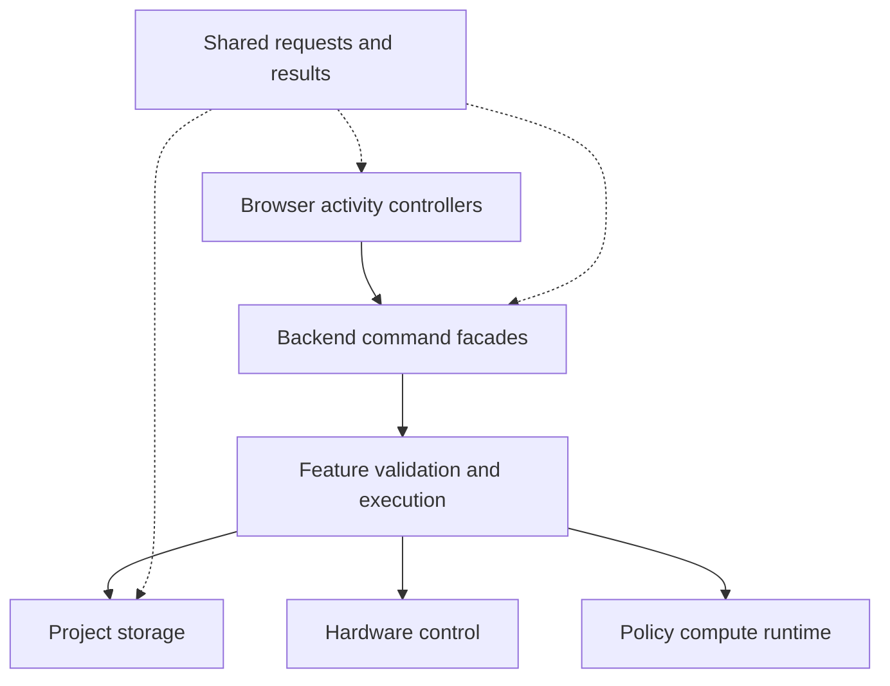

# Architecture cleanup, September 2026

The codebase has two different sources of size: unnecessary translation layers,
and a broad product surface. Removing the first is useful and safe. A substantial
percentage reduction also requires narrowing the second, especially Workflow.
This pass removes approximately 1,000 lines without removing product features.
It is a first structural cleanup, not a claim that the larger reduction is done.

The subsequent [Workflow architecture audit](workflow-architecture-audit.md)
traces execution, Assistant lifecycle, persistence, and restore in detail. It
identifies reductions that preserve the graph and revises the fixed-pipeline
recommendation below; the listed product cuts remain optional.

The starting working tree contained 113,264 lines across 214 Rust, Python,
JavaScript, and CSS source/test files. Counts include comments and blank lines;
they exclude dependencies, generated assets, lockfiles, and documentation.
Existing uncommitted changes were included in the starting snapshot and preserved.

| Area | Starting lines, including tests |
| --- | ---: |
| Backend application | 33,942 |
| Frontend Rust | 27,522 |
| Storage | 18,867 |
| Hardware | 10,033 |
| Shared contracts | 8,688 |
| Frontend CSS | 4,350 |

Workflow alone spans 19,778 lines across its shared contracts, backend, frontend,
and dedicated persistence modules. This excludes its CSS and the Workflow
validation embedded in project transfer. The project bundle implementation is
another 4,658 lines, of which 2,219 are in its final test module. These are areas
to inspect, not estimates of deletable code.

The clearest accumulation pattern was an extra representation at each layer.
A SQL result went from `SpiralQuerySnapshot` through `QueryResult`, a second
`QueryColumn`, and a recursive `QueryValue`, then back to the original shared
types. Settings and robot requests had similar copies. Some generic interfaces
had only one real implementation and tests that called the fake itself.

This pass makes the following changes:

- SQL results travel from storage to the caller in their existing shared type.
  Read-only authorization, preview limits, and failure classification remain.
- Project sessions construct `DataSettings` directly. The duplicate settings
  snapshot and destination types, conversions, and artificial projection fixture
  are removed. A test exercises the real session's settings and secret omission.
- Robot creation and updates use `NewRobot`, `RobotUpdate`, and `PortSettings`
  directly. Validation and disconnect-before-port-change behavior remain.
- Device discovery calls its concrete owners. Serial discovery has one scan
  implementation; camera refresh belongs to `CameraManager`.
- Episode reads and their inspection projection live together in `data/queries`.
  The read-only port and its forwarding adapter are removed.
- All command facades return `BackendCommandError`. Its conversion preserves the
  shared failure code and message. Five identical wrapper implementations and
  an unused direct `syn` development dependency are removed.
- Settings and SQL validation leave the mixed `data/mod.rs` module for their
  respective feature modules.

The intended ownership model is:

Command facades retain project admission and the required backend-runtime
handoff. Feature code should use shared values directly unless another type
enforces an additional invariant. Ports remain useful around physical effects,
compensation, and replaceable compute implementations. A pass-through read does
not need its own generic interface, adapter, result model, and fake.

The subsequent Workflow implementation now gives persisted Assistant history one
storage owner, uses standard SSE framing and cancellation, removes the deferred
Assistant resume loop, and shares graph-source derivation and feature schemas.
Its [implementation and validation record](workflow-architecture-audit.md)
accounts for moved code, retained tests, behavior changes, and remaining work.

For larger product cuts, evaluate these in order:

| Candidate | Retained workflow | Capability lost or changed |
| --- | --- | --- |
| One active Assistant conversation per project | Ask, propose, apply, run, inspect results | Switching among persistent conversations; existing histories need an explicit preservation plan |
| Fixed enrichment pipeline in place of the general Workflow graph | Select source, enrich with SigLIP, query results | Arbitrary multiple-root graph composition and some graph editing |
| Remove in-app whole-project restore | Recording, inspection, query, training, rollout | Restoring `.spiral-project` backups inside Studio; requires an agreed supported restore path |

The graph/pipeline choice has the greatest architectural reach. Multi-conversation
chat is the smaller product tradeoff to assess first. Exact deletion estimates
require tracing each selected cut through contracts, UI, persistence, and tests;
the size of an entire subsystem is not a defensible savings estimate.

Preserve project-session isolation, catalog leases, hardware ordering, query and
import bounds, and atomic persistence. Removing those would exchange visible
line savings for incorrect behavior. Keep the existing desktop boundary and
SpiralDB as the sole persistent store. Any Spiral limitation must be resolved
with the user rather than hidden behind another storage or recovery layer.

Measure subsequent passes by net production-code reduction, fewer owners of the
same state or document, and retained behavioral checks. Moving files, compressing
formatting, or deleting safety tests does not count as architectural progress.

Validation completed for this pass:

- `cargo test -p spiral-robotics-backend --lib --offline`: 270 passed,
  5 existing environment-dependent tests ignored. Local provider tests ran with
  loopback permission. Physical hardware and live Spiral integration were not run.
- `cargo clippy -p spiral-robotics-backend --all-targets --no-deps --offline -- -D warnings -A clippy::suspicious-else-formatting`: passed.
- `cargo check -p spiral-robotics-studio --features server --offline`: passed,
  including the frontend's server-function bindings to the unified command API.
- `cargo fmt --all -- --check` and `git diff --check`: passed.

The broader Clippy invocation that also linted workspace dependencies stopped on
the existing `episodes::episodes` module-inception warning in storage. The
backend-only Clippy result above does not claim a clean workspace-wide lint run.
