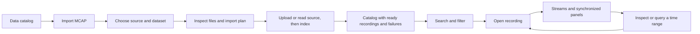

# Data viewer study

**September 7 implementation update:** see [MCAP import and dataset inspection](mcap-import-design.md). The current driver uses native Dataset members and topic readers, not the generated child-table model assumed in this study.

Research date: September 5, 2026. This is a proposal, not an implementation or a confirmed design contract.

The first source is **local or object-storage MCAP recordings**, as selected by the user. The proposed first search scope is recording names, metadata, time, and topic presence; the search-priority question remains unanswered.

## Recommendation

Build one complete path inside Data: **import MCAP → find a recording → inspect synchronized streams → open a matching moment**. Preserve Studio's light desktop workbench, movable panels, SQL, and one Timeline. Make arbitrary recorded data viewable without a configured SO-101 robot.

The largest missing piece is the connection between imported relations and the viewer. A new import form alone will still leave users at “Dataset ready in Query.” Establish the MCAP read and visualization contracts before expanding the interface.

## What exists

| Area | Evidence in the current implementation | Consequence |
| --- | --- | --- |
| Dataset catalog | A dataset ID input with suggestions; newest-first episode rows; select and delete. `DatasetSummary` explicitly includes datasets whose imported relations do not project into recorded episodes. | Dataset identity exists, but there is no useful dataset overview or recording search. An imported dataset can legitimately have no Studio episode rows. |
| Import | Public Hugging Face repository, LeRobot/MCAP format selection, revision pinning, file/size inspection, planned relations, warnings, and transaction-backed import. Existing dataset IDs and output relations are refused. | Reuse source inspection, immutable identity, collision handling, and publication. Local files, object-storage selection, and a durable import-job UI are additional work. |
| MCAP persistence | The importer stages source Blob references and invokes Spiral's MCAP dataset producer. It then writes a dataset catalog row. | Native imported relations are available to Query; the importer does not create a generic recording viewer descriptor or populate the native episode schema. |
| SQL and relations | Read-only SQL, bounded results, eight retained result tabs, schema/relationship inspection, image-aware and video-aware cells. | Keep this expert path. Catalog filters and “open this result at its timestamp” need explicit integration; media cells alone do not provide that navigation. |
| Playback | Selected native episodes attach a complete inspection snapshot; Scene, recorded cameras, and Timeline share state. Signal rendering has six SO-101 joint lanes. | Reuse time ownership and panel infrastructure. Generalize stream discovery and loading instead of representing arbitrary MCAP as six joint signals. |
| Layout | Data currently opens separate Episodes, Query, primary evidence/Relations, Camera, Results, and Timeline tiles. The Timeline occupies only the lower-right part of the default arrangement. | Many empty panels appear before a dataset is useful. The first task should be obvious, and opening data should populate panels based on actual streams. |

Primary code references:

- [Data catalog and import UI](../crates/frontend/src/activities/data/workbench.rs)
- [Data panel composition](../crates/frontend/src/activities/data/screen.rs)
- [Import and native materialization](../crates/backend/storage/src/transfer/ingestion.rs)
- [Dataset identity](../crates/common/src/recording.rs)
- [Episode playback loading](../crates/frontend/src/activities/live/recording_review.rs)
- [Query result rendering](../crates/frontend/src/activities/data/query_result.rs)

Some documentation is stale: PRODUCT.md still says no ingestion implementation exists, and parts of DESIGN.md describe an earlier Data composition. The code above is the evidence for this study. No product/design documents were changed.

## What to learn from Foxglove

Foxglove provides a useful sequence across import, discovery, and visualization:

- Import creates a pending item, exposes processing failures, and does not require a device association. Metadata and attachments remain inspectable. Adopt the visible lifecycle and optional robot identity. [Importing data](https://docs.foxglove.dev/docs/data/importing-data)
- Recordings are searchable by device, time, and metadata; recordings can be opened for visualization or comparison. Adopt a scannable list and a direct open action. [Recordings](https://docs.foxglove.dev/docs/data/recordings)
- Search distinguishes metadata/topic-presence predicates from predicates that decode message contents. Results can be shown as a list, gallery, or timeline. Visual search is a separate beta capability. Adopt the distinction between cheap catalog discovery and deeper content search; start with the list. [Search](https://docs.foxglove.dev/docs/data/search)
- A searchable topic/field browser connects data to Image, Raw Messages, Plot, and other panels, including through drag and drop. Adopt explicit “View” and “Plot” actions first, with keyboard access; dragging can follow. [Panels](https://docs.foxglove.dev/docs/visualization/panels)
- Playback uses one clock, buffers data, and looks back for the latest message on each topic when seeking. Adopt explicit time semantics and bounded loading, including the actual sample time and missing-data behavior. [Playback](https://docs.foxglove.dev/docs/visualization/playback)

Studio's opportunity is to connect that experience to its existing SQL and Workflow features. A selection can eventually become a reproducible training cohort without leaving the project.

## Proposed workflow

### 1. Import

- Put **Import dataset** at the catalog level. Source choices are local MCAP files and an object-storage source; keep the existing Hugging Face path available.
- Local means files on the browser user's computer. A path on the backend machine is a different source and must not be silently substituted.
- Select a new or existing logical dataset explicitly. Appending to an existing dataset needs a supported publication strategy; the current importer only creates new targets.
- Inspect the selected files: names, known size, source identity, destination, and detected format. Display topic counts and duration only when the native inspection actually provides them. Do not imply that a preflight has decoded all content.
- Show persistent import records with real phases and per-file outcomes. Report “ready with issues” when some files fail, and separate catalog readiness from visualization support. No invented percentage during unmeasured indexing.
- End with **Browse imported recordings**, preserving the source and import receipt. A successful database write is not sufficient evidence that camera playback works.

Local bytes should enter Spiral-owned Blob storage through a supported upload path. Object references should use supported Spiral storage access with backend-owned credentials and a stable source version. Confirm support and resource bounds before choosing a mechanism; do not add a filesystem spool or a second database.

### 2. Find data

Keep the existing ordered catalog, but add a real dataset selector and searchable recording rows. Start with name/ID, source, start time, duration, available topics, and import status. Show a thumbnail only where a supported preview exists.

Search starts inside the selected dataset, with explicit “All datasets” scope. Filters should be server-side and paginated so large imports do not require downloading the entire catalog. Preserve filters, sort, scroll, and selected recording when returning from inspection.

Treat three searches separately:

1. **Catalog:** names, metadata, dates, duration, topic presence. First delivery.
2. **Content:** numerical or structured message predicates and SQL. Requires decoded fields. Results carry the recording identity and exact time/range so opening a result seeks correctly.
3. **Visual:** semantic image search. Later; evaluate reuse of Workflow's existing feature machinery once MCAP images have a supported decoding path.

### 3. Inspect a recording

The catalog remains in the left workbench. An opened recording provides its details and a searchable **Streams** list. Streams expose topic, encoding/schema, available fields, and time coverage where known. A schema change within a topic must remain visible.

The main area shows supported camera/image content, plots of selected numeric fields, and a raw-message inspector. Reuse the existing movable panels. Keep Query and Relations available, with deliberate focus actions. Prefer one Timeline across the inspection area; its transport follows the recording rather than the currently focused panel.

Viewing requires no arm connection. 3D robot rendering and training are separate capabilities enabled only when the data satisfies their contracts. A dataset without joint data should not open an empty SO-101 chart.

For a seek, the backend resolves the selected stream windows and the latest appropriate sample. The UI distinguishes a held sample from a gap or unavailable stream. Preserve absolute log timestamps precisely and derive relative display time from a recording origin. Do not pass epoch nanoseconds through a JavaScript number or force asynchronous topics onto one sampled table.

## Data and engineering shape

- Keep the hierarchy **project → dataset → recording/episode → stream → samples**. A logical dataset groups recordings. Initially, treat each MCAP file as one recording; joining split files or defining multiple episodes within a recording is a later explicit operation.
- Add source-neutral descriptors for recordings and streams that reference the authoritative native relations and media. Preserve original filenames, source versions, schema identities, timestamps, and import provenance.
- Retain Studio's existing recorded-episode identity for native recordings. Introduce an adapter to the shared inspection contract, rather than copying every imported message into the arm-specific recording schema.
- Own import jobs in the backend and persist their lifecycle in Spiral. Refresh or navigation must not lose job identity; retry must not create duplicates. A cancel control requires real cancellation semantics and a truthful terminal outcome.
- Use metadata queries for catalog discovery. Request bounded time windows and selected fields for inspection, with bounded prefetch/cache and explicit truncation. The current complete-episode snapshot path should not become the default for multi-gigabyte MCAP.
- Keep decoded fields and media in Spiral's supported query path. If a required decoder, upload API, indexing feature, or transaction operation is missing or broken, discuss that Spiral dependency before adding any workaround.

### Dependencies to resolve before promising the viewer

The locked Spiral revision is `c2a0eb27b136b4b2a29ad0cf3a51b45d28643e98`.

1. The current Studio importer calls `USING spiral.mcap`; the locked robotics plugin declares `spql.mcap.dataset`. Verify the registered producer path end to end before reusing this call. No compatibility fix was attempted.
2. The producer's per-topic output is a raw message record containing timestamps, channel, and binary payload. Its schema output lists schema name/encoding/size. This is not proof of arbitrary ROS/Protobuf field decoding or camera rendering. Establish a supported schema-payload and decoding path for representative MCAP files.
3. Verify large browser uploads, object-store access and credentials, immutable source identity, bounded reads, and append/reimport behavior using the pinned Spiral APIs.
4. Validate actual corrupt-file behavior and job cancellation. Do not promise per-file quarantine or resumability solely from an option name or UI warning.

## First delivery and proof

First resolve the storage connection failure below, then prove one representative MCAP can be imported through native APIs, listed, searched by topic, and opened at an exact timestamp with a decoded numeric field and image stream. This feasibility check determines the supported format matrix.

Build the complete first product path in this order:

1. Recording/stream descriptors and bounded inspection API over native MCAP outputs.
2. Local MCAP import with durable receipt and source identity; object-storage selection through the same contract after its access path is verified.
3. Searchable recording catalog and dataset details.
4. Stream browser, raw-message inspector, numeric plots, supported camera playback, and one synchronized Timeline.
5. SQL-result-to-recording/time navigation; later, saved selections and Workflow handoff.

Acceptance should cover a valid MCAP, repeated import, missing/unknown schema, multiple timestamps, schema changes, a corrupt file, an interrupted job, and a large recording. Import and inspect with no robot configured; seek backward and forward across sparse streams; confirm bounded memory and accurate timestamps. Inspect at 1024 CSS pixels and a wider desktop viewport with mouse and keyboard. No mobile or touch-specific UI.

Defer fleet management, live ROS connectivity, maps/point-cloud breadth, arbitrary user scripts, multi-recording comparison, automatic bucket watching, and semantic search until this path works.

## Observed connection failure

The running Studio at `http://127.0.0.1:62701/data` renders the Data interface, but reports:

> checking SpiralDB namespace spiral_robotics: Other error: SpiralDB storage authorization requires an engine connection

The source trace explains the specific failure:

1. Studio verifies its namespace by fetching the namespace relation's schema.
2. `SpiralConnection::fetch_table_schema` previously called `catalog.bind_relation_opt(&target, &session)` directly.
3. In the locked Spiral revision, that method binds with `transaction = None`.
4. Resolving stored table data requires a transaction's owning engine connection to register the storage mount authorization. Spiral rejects the missing context with this exact error.

This was a mismatch in the connection context used by the metadata lookup. This error by itself did not mean the password was wrong, that the server could not be reached, or that dataset contents were damaged. It prevented the readiness check from succeeding, which disabled catalog/import operations. The ingest existence check used the same direct binding pattern.

The backend adapter now uses Spiral's existing public `CatalogContext::with_transaction` and `Catalog::bind_relation` APIs. It reuses an active connection transaction or opens and closes an inspection transaction on that connection. Ingestion uses the same schema lookup for its existence check. Missing relations remain `None`, and authorization or transport failures remain errors; error-string matching is not used. No Spiral APIs or dependency revisions were changed.

Validation: 89 regular storage tests pass, including five focused connection/transaction tests. An opt-in test against local Spiral API and SpFS also passes: native Arrow create-and-append ingestion, existing/missing schemas, visibility of uncommitted tables, and commit/rollback behavior across connections. The test removes its uniquely named temporary tables. Run it with `SPIRAL_SCHEMA_TEST_CONFIG` pointing to a local Spiral client JSON file and `cargo test -p spiral-robotics-storage native_schema_inspection_supports_ingestion_and_transaction_visibility -- --ignored`.

The release build also passes. After restarting the existing Studio development server, the Data page no longer reports the missing engine connection. Project startup now reaches a separate saved-document compatibility error: the project stores Workflow document version 3, while this checkout's reader supports version 2. That prevents full project readiness; the saved Workflow document was not modified.

MCAP import, decoding, and playback remain separate feasibility work; these storage checks do not establish those capabilities.
