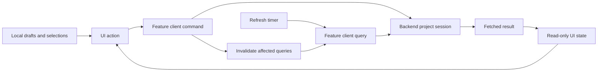

# Frontend state comes from reads

The frontend uses the backend-owned [HTTP API](http-api.md): GET snapshots and
explicit JSON commands, with no Dioxus server-function transport.

The backend owns project state. The browser owns selections, drafts, panel layout,
and a cached copy of fetched state. A command changes the backend and invalidates
related queries. Its response can acknowledge a save or provide a new ID, but does
not replace a fetched value.

## Where to read the code

1. `crates/frontend/src/client/queries.rs` owns query timing, invalidation,
   readiness gating, and read deadlines. It uses ordinary Dioxus resources.
2. `crates/frontend/src/client/project.rs` captures a project ID before a request
   starts and checks it again before delivering the response. Mutations invalidate
   the domains declared by the feature client, including after partial failures.
   Feature clients live beside their consuming UI, such as
   `activities/training/client.rs`; the project client has no feature methods.
3. `crates/frontend/src/shell/project.rs` fetches project identity and readiness
   together. A new ID replaces the keyed project subtree in `shell/routes.rs`.
   A failed read keeps the same subtree and its drafts but withdraws readiness.
4. `crates/frontend/src/shell/state.rs` installs fetched setup, telemetry, and
   rollout values. Training and Workflow create their controllers and history
   resources inside their mounted workspaces. The shell keeps only compact
   status-bar summaries for these features, not their histories or drafts.
5. `crates/backend/src/project_session/queries.rs` exposes project reads;
   `project_session/setup.rs` owns the catalog-backed setup projection. Training,
   rollout, and recording own their snapshots beside their commands. The backend's project admission lock
   still prevents reads or commands from crossing a project replacement.

## Refresh behavior

| Read | Normal interval after completion |
| --- | --- |
| Project identity and readiness | 1 second |
| Latest telemetry | 50 milliseconds |
| Recording chart samples | 200 milliseconds |
| Setup: robots, cameras, mode, issues | 2 seconds |
| Active Workflow, Assistant, rollout | 500 milliseconds |
| Active training | 1 second |
| Idle jobs and dataset/episode catalogs | 5 seconds |
| Settings and relation catalog | 10 seconds |

An invalidation refreshes the affected resources immediately. The timer waits for
completion before counting its delay; it never launches overlapping reads or
restarts a slow read just because another interval elapsed. Changed query inputs
and invalidations cancel obsolete reads. Ordinary backend polling reads are cancellable and
time out after eight seconds; the browser uses a ten-second deadline. First-use
Training and Workflow recovery continues on the backend if the requesting view
closes, because recovery may persist an interrupted job or resume monitoring.
Failed reads retry no faster than once per second, and background browser tabs
slow down to at least five seconds. Mutations are never automatically retried.
Project disposal cancels its frontend tasks; backend-owned jobs retain their own
lifetime and admission rules.

Telemetry freshness advances only when the hardware sequence advances. Successful
polls of a frozen sample do not make robot controls appear fresh.

## History and editing

Training history is requested only while Training is mounted, or while Rollout
needs runs and checkpoint choices. Workflow and Assistant history is requested
only while Workflow is mounted. Leaving these views drops their browser state
and polling; reopening them reads the current backend state. Unsaved drafts and
local selections therefore have the same lifetime as their view.

The backend loads each feature once on its first request, sharing concurrent
initialization attempts and retrying failed loads. Recovery finishes under project
admission before commands can modify history. Remote training execution continues
without the browser; after a backend restart, Studio reattaches monitoring when
Training or Rollout first requests that history. Closing a view does not stop an
already admitted job.

Training queries include the run catalog, latest metrics, and checkpoints, plus
full bounded history only for the selected run while Training is the current
route. The response names which run has complete details. Selecting another run
shows a loading state until its details arrive.

The hardware publisher retains recording chart samples independently of browser
requests. Cursor-based reads return at most 1,000 samples per page. Clients catch
up after a disconnect, and a new take or project clears the previous generation.
The retained window is bounded to roughly thirty minutes at 20 Hz; older samples
are available through the saved episode, rather than an unbounded live chart.

Workflow has one fetched-state acceptance path. Dirty drafts survive refreshes.
A successful Apply records the submitted draft and its accepted revision; only a
subsequent fetch can mark that draft saved. Edits made while saving remain local.
Settings follow the same separation between the last fetched values and the draft.

There is no `/api/events`, EventSource, event inbox, or frontend event reducer.
Camera MJPEG, video downloads, uploads, and the backend's provider streaming
protocol keep their existing media/transport behavior. Internal Workflow completion
and rollout persistence channels remain backend implementation details.
