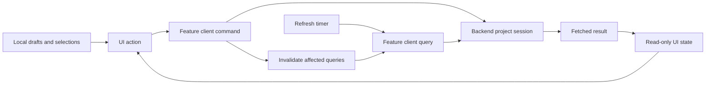

# Frontend state comes from reads

The frontend uses the backend-owned [HTTP API](http-api.md): GET snapshots and
explicit JSON commands, with no Dioxus server-function transport.

The backend owns project state. The browser owns selections, drafts, panel layout,
and a cached copy of fetched state. A command changes the backend and invalidates
related queries. Its response can acknowledge a save or provide a new ID, but does
not replace a fetched value.

## Where to read the code

1. `crates/frontend/src/client/queries.rs` owns query timing, invalidation,
   readiness gating, and read deadlines. It uses ordinary Dioxus resources.
2. `crates/frontend/src/client/project.rs` captures a project ID before a request
   starts and checks it again before delivering the response. Mutations invalidate
   the domains declared by the feature client, including after partial failures.
   Feature clients live beside their consuming UI, such as
   `activities/training/client.rs`; the project client has no feature methods.
3. `crates/frontend/src/shell/project.rs` fetches project identity and readiness
   together. A new ID replaces the keyed project subtree in `shell/routes.rs`.
   A failed read keeps the same subtree and its drafts but withdraws readiness.
4. `crates/frontend/src/shell/state.rs` separates `StudioProjectState` from each
   routed view's `Studio` instance. Project state contains shared configuration,
   setup/readiness, notifications, and navigation requests. Each feature explicitly
   starts the reads it needs when its route mounts. `shell/view_state.rs` provides
   project-lived storage for plain feature values and signals; resources and timers
   belong to mounted components and are never put in that storage.
5. `crates/backend/src/project_session/queries.rs` exposes project reads;
   `project_session/setup.rs` owns the catalog-backed setup projection. Training,
   rollout, and recording own their snapshots beside their commands. The backend's project admission lock
   still prevents reads or commands from crossing a project replacement.

## State ownership

| Owner | Retained state |
| --- | --- |
| Project shell | Connection/readiness, saved configuration, robot setup snapshot, notifications, cross-view navigation requests |
| Live | Capture dataset, robot/joint selection, telemetry freshness, recording samples, timeline position |
| Data | Dataset search, selected dataset/episode/topic/message, episode page, SQL drafts and results, timeline position |
| Training | Dataset choice, training draft, selected/open runs, accepted history |
| Workflow | Workflow draft, graph selection, assistant drafts and accepted history, active panel |
| Rollout | Checkpoint selection, duration draft, robot selection, telemetry and rollout snapshot |
| Settings | Selected section, unsaved configuration, test/save results, robot selection and calibration telemetry |

All six views, including Settings, are ordinary routed components under the
`StudioShell` layout. For example, `/live` renders `LiveWorkspace` and `/data`
renders `DataWorkspace` through `Outlet<StudioRoute>`. Navigating unmounts the
previous route and mounts the next one. There are no empty route components,
hidden retained view components, or per-view activity flags.

The shell provides storage, but each feature defines and initializes its own
state through `ViewState::use_retained`. State is created on first use, keyed by
activity and Rust type, and its signals belong to the keyed project scope.
Factories create only plain values and signals, never hooks or asynchronous
resources. Reusable controllers have separate instances in views that need them;
changing Live's capture dataset does not change Training's draft.

## Refresh behavior

| Read | Owner / when enabled | Interval after completion |
| --- | --- | --- |
| Project identity and readiness | Project connection | 1 second |
| Setup: robots, cameras, mode, issues | Project shell | 2 seconds |
| Settings | Project shell; shared configuration | 10 seconds |
| Latest telemetry | Current Live, Rollout, or Settings view | 50 milliseconds |
| Recording chart samples | Live, with a recording present | 200 milliseconds |
| Workflow and Assistant | Current Workflow view | 500 milliseconds when busy; 5 seconds idle |
| Rollout snapshot | Current Rollout view | 500 milliseconds when busy; 5 seconds idle |
| Training history / checkpoint choices | Current Training or Rollout view | 1 second |
| Dataset / episode choices for capture and training | Current Live or Training view | 5 seconds |
| Relation catalog | Current Data, Workflow, or Training view | 10 seconds |
| Native dataset inspection / previews | Mounted Data panels | On selection or explicit refresh |

Settings needs hardware readings for robot calibration and setup commands. This
is independent of Live's retained telemetry. Data, Training, and Workflow do not
poll telemetry, recording samples, or rollout status.

An invalidation refreshes enabled resources immediately. Inactive views stay idle
and fetch with the latest inputs when reactivated. The timer waits for
completion before counting its delay; it never launches overlapping reads or
restarts a slow read just because another interval elapsed. Changed query inputs
and invalidations cancel obsolete reads. Ordinary backend polling reads are cancellable and
time out after eight seconds; the browser uses a ten-second deadline. First-use
Training and Workflow recovery continues on the backend if the requesting view
closes, because recovery may persist an interrupted job or resume monitoring.
Failed reads retry no faster than once per second, and background browser tabs
slow down to at least five seconds. Mutations are never automatically retried.
Project disposal cancels its frontend tasks; backend-owned jobs retain their own
lifetime and admission rules.

Telemetry freshness advances only when the hardware sequence advances. Successful
polls of a frozen sample do not make robot controls appear fresh.

## History and editing

Each view retains drafts, selections, and accepted results in project-lived
storage. Leaving a route unmounts its components, including media streams,
canvases, resources, and timers. Dioxus cancels those component-owned tasks.
Returning constructs fresh components, retrieves retained values, and requests
current backend data. Dock layout uses the workbench's existing persistence.

`QueryPolicy` does not need a view activity flag. An unmounted view has no resource
to refresh; returning starts a fresh read with current inputs. Every docked panel
in the current view counts as active, even when its tab is hidden.

Settings is an ordinary `/settings` route. It has no Close/Done action or Escape
handler that returns to a previous view. Its section and draft survive navigation;
Discard changes resets the draft without navigating. Explicitly submitted commands
are owned by the project and can complete after navigation. A project change drops
all retained values and cancels the project's frontend tasks.

Telemetry freshness is cleared on mount and unmount, so a cached sample cannot
enable robot controls before an advancing sample arrives. Browser preview playback
stops on unmount while its timeline position remains retained.

The backend loads each feature once on its first request, sharing concurrent
initialization attempts and retrying failed loads. Recovery finishes under project
admission before commands can modify history. Remote training execution continues
without the browser; after a backend restart, Studio reattaches monitoring when
Training or Rollout first requests that history. Closing a view does not stop an
already admitted job.

Training queries include the run catalog, latest metrics, and checkpoints, plus
full bounded history only for the selected run while Training is the current
route. The response names which run has complete details. Selecting another run
shows a loading state until its details arrive.

The hardware publisher retains recording chart samples independently of browser
requests. Cursor-based reads return at most 1,000 samples per page. Clients catch
up after a disconnect, and a new take or project clears the previous generation.
The retained window is bounded to roughly thirty minutes at 20 Hz; older samples
are available through the saved episode, rather than an unbounded live chart.

Workflow has one fetched-state acceptance path. Dirty drafts survive refreshes.
A successful Apply records the submitted draft and its accepted revision; only a
subsequent fetch can mark that draft saved. Edits made while saving remain local.
Settings follow the same separation between the last fetched values and the draft.

There is no `/api/events`, EventSource, event inbox, or frontend event reducer.
Camera MJPEG, video downloads, uploads, and the backend's provider streaming
protocol keep their existing media/transport behavior. Internal Workflow completion
and rollout persistence channels remain backend implementation details.
