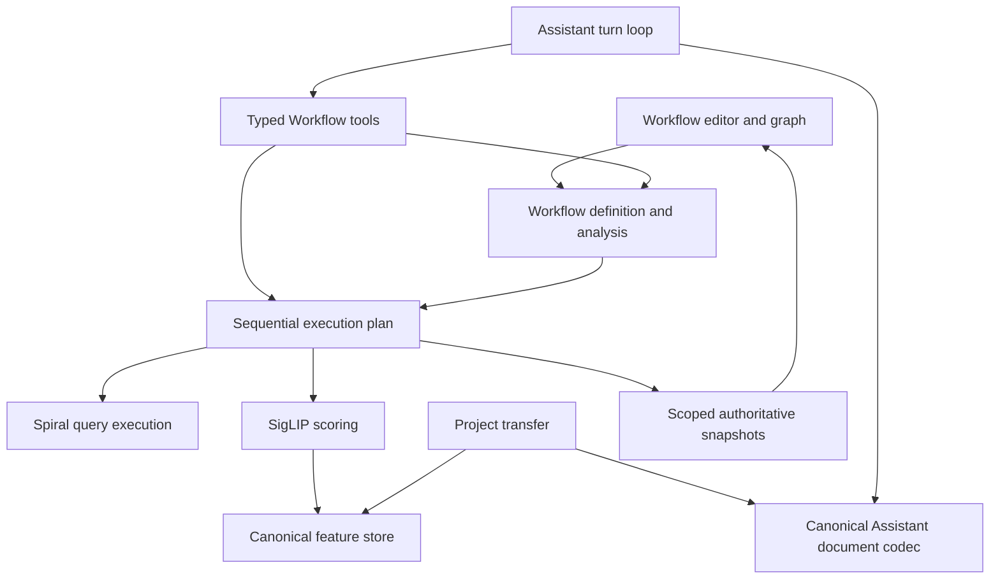

# Workflow architecture audit — September 2026

Workflow can be substantially simpler without first removing its graph or model
enrichment. Its main architectural cost is representing the same facts in several
places, plus an Assistant lifecycle more elaborate than its execution requires.
There are also small pieces of standard infrastructure implemented by hand.

This audit inspected commit `90201cf`, followed manual editing and Assistant
commands through validation, execution, persistence, restart, project transfer,
and browser reconciliation, and checked the pinned dependencies. The findings describe that baseline. Six temporary characterization probes
confirmed the provider and history-validation findings; their passing assertions
demonstrated defects before the implementation below. Historical source links
are pinned to the audited commit.

**Implementation following the audit**

The working tree now implements the history, streaming, and Assistant lifecycle
cleanup. The graph editor, multi-root graphs, model enrichment, project bundles,
and persistent conversation switching remain available.

- [Assistant history](../crates/backend/storage/src/workflow_assistant.rs) owns
  the versioned document, conversations, provider messages, structural checks,
  bounds, and restart recovery. Runtime loading and bundle import call its same
  decoder. The 14 import-only shadow types and second history validator are gone.
  Saving serializes the validated document once. Unknown nested fields, missing
  required fields, empty message IDs, and oversized byte identities are refused
  consistently. Existing writer-generated version-2 histories retain their format.
- [The Assistant runtime](../crates/backend/src/workflow/agent.rs) keeps a single
  provider loop and budget. `run_workflow` stays pending until the run is durably
  terminal; `wait_for_run` still supports observing an existing manual run. There
  is no 60-second timeout, synthetic completion exchange, receipt repair, or
  outer resume loop. Public tool completion and the matching provider result are
  committed in one candidate and one save. Historical deferred fields remain
  decodable and are cleared during restart recovery.
- [Provider transport](../crates/backend/src/workflow/provider.rs) uses
  `eventsource-stream` 0.2.3 for SSE framing. Application policy still bounds bytes,
  validates completion and tool calls, and redacts errors. Multiline events and
  split UTF-8 are accepted; premature EOF, provider generation errors, truncated
  arguments, and unsupported finish reasons fail explicitly. `[DONE]` ends the
  stream. Tokio cancellation tokens replace polling throughout Assistant,
  provider, executor, and model code. The publication mutex remains in place.
- [Shared Workflow analysis](../crates/common/src/workflow.rs) now owns model
  source normalization and indexed lineage traversal. The browser and executor
  use the same derivation, including clearing ambiguous or disconnected sources.
  The backend also uses the existing shared SQL placeholder scanner.
- [Workflow feature schemas](../crates/backend/storage/src/workflow_features.rs)
  own the registry schema and its validation, cache key rules, limits, and producer
  constants. Provisioning, model execution, and bundle validation use that owner.
  Inference no longer imports model identity from the project-transfer module.

Compared with `90201cf`, the changed Rust files contain **651 fewer lines outside
final test modules** and **389 fewer total lines**, including the new storage
module and retained/moved regression tests. Counts include comments and blank
lines; test-only helpers outside the final module make the first figure an
approximation of implementation size. File movement is included in both totals.
This is an additional reduction after the earlier general architecture cleanup.

The visible lifecycle change is one continuing Assistant turn while a run executes,
followed by its ordinary tool result and answer. Restart continues to interrupt
active work. This does not add durable continuation across application restarts.

Remaining architectural work is explicit: compile execution into a sequential
plan; consolidate feature registry/cache row codecs and semantic validation;
replace duplicate transaction-policy fixtures with tests of their actual owners;
and simplify frontend node projection and observation sequencing. The schema
consolidation above does not replace the whole feature persistence subsystem.
No Spiral behavior or storage algorithm was changed to work around a limitation.

**Implementation validation**

- Combined library suites for backend, frontend with its `server` feature, storage,
  and common: **547 passed, 10 existing integration tests ignored**. Breakdown:
  backend 260, frontend 132, storage 104, common 51. The command used
  `cargo test`, all four package selections, `--features spiral-robotics-frontend/server`,
  and `--lib --offline --locked`. Provider HTTP fixtures used localhost permission;
  no LLM service was called.
- Clippy passed for backend, frontend, and common with `--all-targets --no-deps`,
  the frontend server feature, `--offline --locked`, and
  `-D warnings -A clippy::suspicious-else-formatting`. The formatting allowance is
  the same one used by the preceding cleanup.
- `cargo check -p spiral-robotics-studio --features server --offline --locked`
  passed, including server-function bindings.
- `cargo fmt --all -- --check` and `git diff --check` passed.

New or extended regressions cover malformed and incomplete streams, `[DONE]`,
multiline framing, idle-stream cancellation, shared history identity/field/byte
bounds, paired public/provider tool completion, results receipts, failed terminal
saves, lagging run subscribers, cancellation/start ownership, and graph-source
normalization. Existing registry provenance, cache, publication ordering, restart,
conversation bounds, and frontend reconciliation tests remain in the suites.
Live Spiral/SpFS integration, model artifact downloads, physical hardware,
real-provider integration, and browser interaction were not exercised.

**Measured scope**

| Area | Lines outside final test modules | Lines in final test modules | Total |
| --- | ---: | ---: | ---: |
| Assistant and provider | 3,607 | 1,292 | 4,899 |
| Execution, model, admission, command facade | 4,616 | 2,477 | 7,093 |
| Frontend Workflow | 3,756 | 865 | 4,621 |
| Shared Workflow contracts | 2,149 | 553 | 2,702 |
| Dedicated Workflow persistence | 370 | 59 | 429 |
| **Total, 13 files** | **14,498** | **5,246** | **19,744** |

Counts include comments and blank lines. Some test-only helpers occur outside
the final test modules, so 14,498 is an approximate implementation footprint,
not an exact production-code count. This excludes CSS, the shared SQL parser,
shared HTTP/SSE infrastructure, and Workflow-specific code in the 4,658-line
project bundle module. None of these totals is a deletion estimate.

**What the feature actually does**

Manual editing and the Assistant both produce a `WorkflowSpec`. The backend
normalizes model sources, validates the graph, and saves it with a run snapshot.
Execution walks nodes sequentially. Table nodes resolve catalog entries;
intermediate Query nodes compose SQL; Model nodes backfill a persistent feature
cache; the Query feeding Result executes a bounded preview. Result selects that
payload. The browser reconciles authoritative snapshots with its editable draft.

The Assistant adds seven tools, streamed text, up to 20 persistent conversations,
run ownership, cancellation, and a timeout/deferred-completion loop. Restart marks
active work interrupted. Project backup/restore validates its persisted formats
through a separate implementation.

The graph is useful as a representation of lineage. It does not require a
general-purpose workflow scheduler: execution is sequential, there is exactly
one terminal Result, and the only executable Model family is SigLIP.
See [execution](https://github.com/spiraldb/spiral-robotics/blob/90201cfd28e0026854b939549f1b46feeb59199e/crates/backend/src/workflow/manager.rs#L820) and
[graph validation](https://github.com/spiraldb/spiral-robotics/blob/90201cfd28e0026854b939549f1b46feeb59199e/crates/common/src/workflow.rs#L1597).

**1. Consolidate persisted Assistant history first — high confidence, no feature cut**

Normal loading owns `AgentDocument`, conversations, public sessions, and provider
messages. Bundle restore recreates that shape with 14 shadow types, then parses
JSON into both typed structures and `serde_json::Value` and walks it again.
Tool-call ordering and identity limits are implemented twice.

The copies have already diverged. A current-version document containing one user
message with an empty ID passes normal `restored_snapshot`, but the exact same
serialized document fails bundle validation. Conversation IDs also have a
128-byte limit on normal load and a 128-character limit during import. These
are malformed-input inconsistencies; the audit does not establish that ordinary
UUID-generated conversation histories fail backup.

Use one storage-owned, versioned Assistant document codec and validator for
loading, saving, and project transfer. Backend turn-management methods can wrap
that document. Provider request types should be adapted at the transport boundary
when necessary; raw provider history should remain out of browser contracts.
Preserve unsupported-version refusal, incomplete-tool-exchange handling, and
history bounds.

Evidence: [normal validator](https://github.com/spiraldb/spiral-robotics/blob/90201cfd28e0026854b939549f1b46feeb59199e/crates/backend/src/workflow/agent.rs#L388),
[shadow types](https://github.com/spiraldb/spiral-robotics/blob/90201cfd28e0026854b939549f1b46feeb59199e/crates/backend/storage/src/transfer/bundle.rs#L74), and
[import validator](https://github.com/spiraldb/spiral-robotics/blob/90201cfd28e0026854b939549f1b46feeb59199e/crates/backend/storage/src/transfer/bundle.rs#L1240).
The shadow declarations and import history validator occupy about 400 lines;
some responsibilities move into the canonical owner, so those are not 400 net
deletable lines.

**2. Replace the deferred/resume loop with a pending tool call — high value**

`wait_for_run` waits at most 60 seconds. A timeout writes a deferred run identity,
completes the current public assistant message, and exits the inner provider
loop. The outer loop then waits for the same run in the same task. On completion,
it rewrites a receipt, injects a synthetic user message into provider history,
creates another assistant message, and re-enters the provider loop.

This is two implementations of waiting, with an extra conversation transition
between them. The timeout does not release the backend task. It also does not
provide durable continuation across application restart: restore interrupts
active turns.

Keep `wait_for_run` pending until the run reaches a durably committed terminal
state, with cancellation and UI progress still active. Return one ordinary tool
result, then let the existing provider loop produce the follow-up. This removes
the timeout parameter, deferred identifiers, synthetic resume messages, receipt
repair, and the outer resume loop. Optionally make `run_workflow` wait and remove
the separate wait tool after validating whether inspection of already-running
manual runs needs that tool.

Automatic follow-up remains. The observable change is one continuing Assistant
turn instead of a timeout message followed by a synthetic completion exchange.
Keep a single tool/iteration budget, owned-run cancellation, restart interruption,
and terminal-persistence checks. Historical deferred documents still need to be
decoded safely.

Evidence: [outer loop](https://github.com/spiraldb/spiral-robotics/blob/90201cfd28e0026854b939549f1b46feeb59199e/crates/backend/src/workflow/agent.rs#L1422),
[timed wait](https://github.com/spiraldb/spiral-robotics/blob/90201cfd28e0026854b939549f1b46feeb59199e/crates/backend/src/workflow/agent.rs#L1792), and
[deferred lifecycle](https://github.com/spiraldb/spiral-robotics/blob/90201cfd28e0026854b939549f1b46feeb59199e/crates/backend/src/workflow/agent.rs#L2128).

**3. Compile the graph once; derive redundant relationships**

The shared validator and manager have two implementations of the exact
`{{node:id}}` placeholder scanner. Model source lineage is separately traversed
in shared validation, backend normalization, and frontend editing. Query
dependencies must be expressed twice: as placeholders and as edges, with code
rejecting either representation when the two disagree. Each feature additionally
stores a source relation the backend derives from the graph.

Start with one shared placeholder parser and one graph-analysis owner that
computes incoming dependencies, model source lineage, and execution order. The
backend can compile its accepted graph into an ordered list of enrichment steps
and a final SQL query. Carry node IDs for progress and error attribution. Keep
the graph and wire format initially; this avoids coupling a persistence migration
to the first execution cleanup.

After that, consider deriving Query input edges from their placeholders and
storing only explicit Model input and Result selection. That removes two sources
of truth from authoring and from the LLM tool schema. Model source relation can
be derived for execution and made explicit when registering a persistent feature.
A versioned format change would need fixtures proving old graphs retain their
meaning.

The canvas already uses `dioxus-flow` and disables arbitrary connection creation.
Keeping this visualization costs no new graph framework. The local topological
sort is only about 44 lines; replacing it with a graph library alone is a small
opportunity and may add conversions. Do not introduce a node trait hierarchy or
a scheduler framework to perform the existing sequential loop.

Evidence: [shared scanner](https://github.com/spiraldb/spiral-robotics/blob/90201cfd28e0026854b939549f1b46feeb59199e/crates/common/src/sql/workflow.rs#L98),
[second scanner](https://github.com/spiraldb/spiral-robotics/blob/90201cfd28e0026854b939549f1b46feeb59199e/crates/backend/src/workflow/manager.rs#L1628),
[shared lineage](https://github.com/spiraldb/spiral-robotics/blob/90201cfd28e0026854b939549f1b46feeb59199e/crates/common/src/workflow.rs#L1673),
[backend lineage](https://github.com/spiraldb/spiral-robotics/blob/90201cfd28e0026854b939549f1b46feeb59199e/crates/backend/src/workflow/manager.rs#L1746),
[frontend lineage](https://github.com/spiraldb/spiral-robotics/blob/90201cfd28e0026854b939549f1b46feeb59199e/crates/frontend/src/activities/workflow/state.rs#L1728), and
[canvas configuration](https://github.com/spiraldb/spiral-robotics/blob/90201cfd28e0026854b939549f1b46feeb59199e/crates/frontend/src/activities/workflow/workspace.rs#L1317).

There is a related semantic inconsistency: intermediate Query nodes retain and
validate `max_rows`, but execution only applies it to the Query feeding Result.
Intermediate SQL is substituted without that limit. Make the value explicitly
a final-result preview limit; candidate cohort bounds belong in candidate SQL.
Do not silently add LIMIT to intermediate queries, which would change results.
See [Query execution](https://github.com/spiraldb/spiral-robotics/blob/90201cfd28e0026854b939549f1b46feeb59199e/crates/backend/src/workflow/manager.rs#L913).

**4. Stop maintaining a partial SSE implementation — confirmed defects**

The provider reads HTTP bytes, scans newline boundaries, and parses each `data:`
line as JSON. A standards-conforming SSE event can contain multiple data lines;
the data must be assembled at event boundaries. The current parser also ignores
`[DONE]`, does not require a completion signal before accepting EOF, and ignores
provider error fields and `finish_reason`.

Four in-memory probes against the actual `ProviderResponse::from_stream` showed:

| Input | Observed current behavior |
| --- | --- |
| One JSON event split across two SSE `data:` lines | Rejected as malformed JSON |
| A content delta followed by EOF without completion | Returned as a successful response |
| `[DONE]` followed by another content event | Later content still accepted |
| OpenRouter-shaped error with `finish_reason: "error"` | Returned as an empty successful response |

These are transport correctness problems, not cosmetic cleanup. OpenRouter
documents errors inside successful HTTP streams, including the error completion
reason. [OpenRouter error protocol](https://openrouter.ai/docs/api_reference/errors-and-debugging).
Multiline event framing is defined by the
[SSE standard](https://html.spec.whatwg.org/multipage/server-sent-events.html#parsing-an-event-stream).

Use a small SSE decoder such as `eventsource-stream` for event framing, retaining
a small provider-specific accumulator for content, tool fragments, explicit
completion, and errors. Its documented interface adapts a byte stream such as
Reqwest's directly. Preserve the byte limit before decoding, bounded tool counts,
timeouts, secret redaction, and cancellation. A framing library alone does not
fix provider completion semantics.
[eventsource-stream documentation](https://docs.rs/eventsource-stream/0.2.3/eventsource_stream/).

An entire agent framework is not the first replacement to make: its transport
support would not remove project revisions, leases, run ownership, persistence,
and bounded evidence. This provider supports an OpenAI-compatible endpoint and
defaults to OpenRouter; a provider-specific API migration is a separate decision.

Evidence: [stream parser](https://github.com/spiraldb/spiral-robotics/blob/90201cfd28e0026854b939549f1b46feeb59199e/crates/backend/src/workflow/provider.rs#L530).

**5. Give feature persistence one owner; keep inference with the model**

`model.rs` mixes candidate scanning, feature definitions, registry decoding,
cache decoding, Arrow schemas, transactions, image preprocessing, model loading,
and inference. Project transfer duplicates registry/cache validation, the
14-field registry schema, key fields, bounds, and producer semantics. Model
identity constants currently live in the project bundle module and are imported
by inference code.

Put the feature registry/cache format and its codecs in the existing storage
Workflow feature module. Both normal model execution and transfer should use
them. Give `WorkflowFeatureDefinition` one semantic validation method used by
graph admission and the storage codec. Keep candidate scanning, preprocessing,
and scoring with the backend model owner. This creates a boundary at an actual
responsibility and removes duplicate format knowledge.

Evidence: [model registry loading](https://github.com/spiraldb/spiral-robotics/blob/90201cfd28e0026854b939549f1b46feeb59199e/crates/backend/src/workflow/model.rs#L940),
[model registry validation](https://github.com/spiraldb/spiral-robotics/blob/90201cfd28e0026854b939549f1b46feeb59199e/crates/backend/src/workflow/model.rs#L1052),
[import registry validation](https://github.com/spiraldb/spiral-robotics/blob/90201cfd28e0026854b939549f1b46feeb59199e/crates/backend/storage/src/transfer/bundle.rs#L1478),
[import cache validation](https://github.com/spiraldb/spiral-robotics/blob/90201cfd28e0026854b939549f1b46feeb59199e/crates/backend/storage/src/transfer/bundle.rs#L1771), and
[model constants in transfer](https://github.com/spiraldb/spiral-robotics/blob/90201cfd28e0026854b939549f1b46feeb59199e/crates/backend/storage/src/transfer/bundle.rs#L46).

The cache algorithm also deserves a separate performance investigation: it loads
the source cache into a Rust `BTreeMap`, merges cells, and replaces the whole cache
and registry transactionally. Missing-feature runs scan the candidate SQL twice.
The one-million-row bound is not a measurement of affordable memory or latency.
No benchmark was run in this audit. Redesigning this around native incremental
database mutation requires verifying Spiral's supported semantics with the user;
do not add another database, private log, or compatibility workaround.

**6. Standard libraries can replace small local mechanisms**

| Local mechanism | Simpler owner | Conditions |
| --- | --- | --- |
| Custom dotenv quoting/escaping | `dotenvy::from_read_iter` | Retain private-file checks, size limits, selected keys, process-variable precedence, and sanitized errors. Its expansion/error semantics differ; use compatibility fixtures before changing it. |
| Atomic flag plus 50 ms async cancellation polling | `tokio_util::sync::CancellationToken` | Keep the publication mutex that orders cancellation against committed feature writes, and cooperative checks during blocking inference. |
| Handwritten tool JSON Schema alongside manual JSON argument extraction | Typed tool arguments with `schemars` | Keep semantic admission rules; schema generation alone is not runtime validation. Verify the provider-accepted schema subset. |

All three crates already occur in the locked dependency graph, though the
relevant crate must declare a direct dependency before using one. The documented
APIs provide [dotenv iteration](https://docs.rs/dotenvy/0.15.7/dotenvy/fn.from_read_iter.html),
[awaitable cancellation](https://docs.rs/tokio-util/0.7.19/tokio_util/sync/struct.CancellationToken.html),
and [Rust-derived JSON Schema](https://docs.rs/schemars/1.2.2/schemars/).
These are modest reductions; they do not account for thousands of lines alone.

Tool definitions should own their name, arguments, schema, and presentation
metadata together. Currently names and argument knowledge are repeated in the
tool schema, dispatch, and presentation code. A narrow enum for the seven tools
is sufficient; a generic tool registry is unnecessary.
See [schemas](https://github.com/spiraldb/spiral-robotics/blob/90201cfd28e0026854b939549f1b46feeb59199e/crates/backend/src/workflow/agent.rs#L2307),
[dispatch](https://github.com/spiraldb/spiral-robotics/blob/90201cfd28e0026854b939549f1b46feeb59199e/crates/backend/src/workflow/agent.rs#L1612), and
[dotenv parser](https://github.com/spiraldb/spiral-robotics/blob/90201cfd28e0026854b939549f1b46feeb59199e/crates/backend/src/workflow/provider.rs#L150).

**7. Reduce state translation and use an explicit observation sequence**

The frontend copies config, execution status, model metadata, and source details
into `WorkflowNodeData` and three supporting structs, then exposes another set
of getters. Much of this is a second representation of the shared node spec and
snapshot. Keep those canonical values in the canvas node's data and derive
labels/description for rendering. Geometry and selection remain browser-owned.
This is a targeted reduction, not a reason to remove the editable draft.

The frontend also compares workflow revision, run identity, millisecond
timestamps, and phase rank to order updates. Same-millisecond updates in the same
phase are indistinguishable to that rule. A server-issued observation sequence
within each project scope would make reconciliation smaller and explicit, much
as the Assistant already uses a revision. Increment it at state mutation, not
whenever a response is serialized. Preserve separate scope checks for streamed,
bootstrap, and command responses and the existing race tests.

Evidence: [copied node data](https://github.com/spiraldb/spiral-robotics/blob/90201cfd28e0026854b939549f1b46feeb59199e/crates/frontend/src/activities/workflow/state.rs#L48),
[projection](https://github.com/spiraldb/spiral-robotics/blob/90201cfd28e0026854b939549f1b46feeb59199e/crates/frontend/src/activities/workflow/state.rs#L1941), and
[reconciliation](https://github.com/spiraldb/spiral-robotics/blob/90201cfd28e0026854b939549f1b46feeb59199e/crates/frontend/src/activities/workflow/state.rs#L1420).
The ordering concern is source-level analysis; it was not reproduced in a live UI.

**8. Commit a tool result and its public summary together**

For each tool, `tool_finished` saves its public summary; `record_tool_output` then
saves its provider result in a second full-document write. Both clone the
document. Each save validates and serializes the history, and storage rewrites
the document relation while preserving the other document in the transaction.
Combine these into one `complete_tool` transition and durable write. This removes
a partial-completion boundary and repeated work without changing features.

Token deltas are already published in memory rather than saved individually.
Likewise, model progress without a phase change already avoids durable writes.
Do not attribute per-token database writes to the current implementation.

Evidence: [tool execution order](https://github.com/spiraldb/spiral-robotics/blob/90201cfd28e0026854b939549f1b46feeb59199e/crates/backend/src/workflow/agent.rs#L1587),
[tool completion](https://github.com/spiraldb/spiral-robotics/blob/90201cfd28e0026854b939549f1b46feeb59199e/crates/backend/src/workflow/agent.rs#L1985),
[provider-result write](https://github.com/spiraldb/spiral-robotics/blob/90201cfd28e0026854b939549f1b46feeb59199e/crates/backend/src/workflow/agent.rs#L1919), and
[document persistence](https://github.com/spiraldb/spiral-robotics/blob/90201cfd28e0026854b939549f1b46feeb59199e/crates/backend/storage/src/workflow_documents.rs#L112).

**9. Some transaction tests execute a second implementation**

`FeaturePublicationTransaction::run_publication` exists only under `cfg(test)`.
Its fake tests exercise that helper, while production `FeaturePublication::replace`
contains separate transaction control flow. Bundle import has the same pattern
with `ProjectImportTransactionRunner`. These tests cannot establish the behavior
of the production transaction paths they resemble.

Share the production transaction finalization policy through the storage owner,
and inject failures beneath that policy. Preserve import's distinct reconnect
requirement and feature publication's cancellation gate. Then delete the copied
test-only algorithms. This is a better reduction than dropping failure tests or
counting their existing passes as sufficient coverage. Existing ignored live
transaction tests remain valuable but require an isolated Spiral environment.

Evidence: [production publication](https://github.com/spiraldb/spiral-robotics/blob/90201cfd28e0026854b939549f1b46feeb59199e/crates/backend/src/workflow/model.rs#L1660),
[test-only publication algorithm](https://github.com/spiraldb/spiral-robotics/blob/90201cfd28e0026854b939549f1b46feeb59199e/crates/backend/src/workflow/model.rs#L1741),
[test-only import algorithm](https://github.com/spiraldb/spiral-robotics/blob/90201cfd28e0026854b939549f1b46feeb59199e/crates/backend/storage/src/transfer/bundle.rs#L2022), and
[production import finalization](https://github.com/spiraldb/spiral-robotics/blob/90201cfd28e0026854b939549f1b46feeb59199e/crates/backend/storage/src/transfer/bundle.rs#L2085).

**10. Spiral is the upstream boundary for a larger inference reduction**

The pinned `spiral-ai` already provides `spql.ai.embed` for CLIP image vectors,
`spql.ai.estimate_depth`, and `spql.ai.detect`. It does not expose the current
SigLIP concept/image probability operation. Those operations have different
outputs and cannot replace SigLIP without changing product semantics. This was
verified in the locked Spiral checkout at `c2a0eb27`, specifically
`engine/plugins/spiral-ai/src/lib.rs`, registration methods around lines 433–530.

Studio already reuses Candle's SigLIP implementation, Hugging Face artifact
loading, tokenizers, and the image library. It has not implemented a neural
network from scratch. See [SigLIP loading](https://github.com/spiraldb/spiral-robotics/blob/90201cfd28e0026854b939549f1b46feeb59199e/crates/backend/src/workflow/model.rs#L2235).

The Assistant prompt also contains roughly 994 words of workflow instructions
and concrete SQL recipes, including workarounds for asserted Spiral limitations
around LEAD/LAG, lateral queries, and generator aliases. The audit found those
instructions in source; it did not independently re-test each database
limitation. These should become explicit upstream capability decisions with
the user, rather than an expanding collection of prompt recipes. Adding a
SigLIP function upstream could remove local orchestration, but requires a
separate design for feature provenance, cache publication, and cancellation.
No Spiral workaround or upstream change was implemented in this audit.

**Proposed ownership after cleanup**

These are owners and data flows, not a proposal for a new crate or interface for
every box. Retain project-session isolation, catalog leases, read-only SQL
admission, result/media bounds, atomic feature/cache publication, stale-result
handling, cancellation ordering, and versioned document refusal.

**Recommended execution order and optional cuts**

| Pass | Concrete outcome | Validation that matters |
| --- | --- | --- |
| 1 | Canonical Assistant codec; correct provider event framing/completion | Same fixtures accepted/rejected by load and restore; four stream cases become correct-behavior regressions; retain bounds and redaction cases |
| 2 | One tool-completion write; one pending-run wait; standard cancellation | Long run, cancel/start race, restart during tool exchange, terminal-persistence failure, unchanged turn budget |
| 3 | One SQL scanner and graph analysis; sequential execution plan | Existing multi-root and chained-query graphs retain final SQL, source lineage, outputs, and failure attribution |
| 4 | Canonical feature-store codec and real transaction-policy tests | Registry/cache round trips, malformed import, provenance conflict, cancellation/publication ordering, rollback and uncertain commit |
| 5 | Smaller node projection and explicit observation sequence | Dirty draft preservation, slow HTTP response after SSE, project switch, equal-time progress updates |

Measure each pass by net implementation reduction and the number of remaining
independent representations. The audit supports several hundred lines of direct
duplication removal plus broader lifecycle and execution reductions. A precise
percentage or a claim that half of Workflow can disappear would be premature;
moving code between files and deleting useful tests should not count as savings.

If additional functionality cuts are wanted, consider these after consolidation:

| Cut | Retained behavior | Actual tradeoff |
| --- | --- | --- |
| One Assistant conversation per project | Ask, save graph, run, automatic follow-up | Persistent conversation switching disappears; existing histories need an explicit preservation decision |
| Whole assistant responses instead of token streaming | Tools, progress, cancellation, completed answers | Text appears when the response finishes; provider completion becomes ordinary bounded JSON |
| One fixed enrichment pipeline | Source, candidate SQL, SigLIP features, final SQL, graph display | Arbitrary multi-root/chained graph composition is restricted |

I would keep multiple roots and the graph for the first passes. This revises the
earlier cleanup note's emphasis on replacing the general graph with a fixed
pipeline: inspection shows a meaningful reduction is available while preserving
its useful lineage representation. Dropping project restore is also unnecessary
to eliminate its duplicate Workflow codecs.

**Original audit validation record**

The audit ran `cargo metadata --offline --locked`, inspected the resolved
dependency sources, and checked the primary library/protocol documentation
linked above. Five temporary backend tests and one storage test passed, confirming
the four stream behaviors and the normal-load/import disagreement. Provider
tests constructed in-memory Reqwest responses; they did not call an LLM service
or open a network listener. The storage probe validated the same JSON fixture
without writing a project. Temporary test module declarations were removed and
application files returned to their exact pre-audit contents.

The probes and logs remain under `/private/tmp/rerobot-workflow-*audit*` for this
session. The history reproduction creates a default `AgentDocument`, appends
`WorkflowAgentMessage::new("", WorkflowAgentRole::User)`, serializes it, then
passes that same JSON to `restored_snapshot` and `BundleAgentDocumentV2::validate_json`.
These are characterization checks, not a full regression run. No live Spiral
project, model artifact download, physical hardware, browser behavior, or
performance benchmark was exercised. No product functionality was removed.
