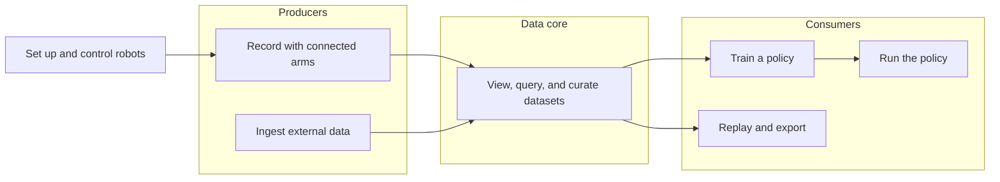

# Spiral Robotics specification

This specification is organized by product feature. A feature document keeps
its user flow, visible behavior, data rules, safety rules, and implementation
ownership together.

Spiral Robotics is a Rust-native robotics system and browser Studio for an ML
engineer working with robot data. The data core — one SpiralDB project of
datasets and episodes — is the center of the product. Producers put episodes
in: recording with SO-ARM101 leader and follower arms, and ingestion from
external sources. Consumers take data out: query, curation, training,
rollout, replay, and export.

## Product flow

## Features

- [Studio workspace](studio/README.md) — navigation, panels, Scene, charts,
  status, notifications, and the shared
  [interaction language](studio/interaction-language.md).
- [Robots](robots/README.md) — robot instances, setup, camera assignment,
  calibration, connection, and motion control.
- [Recording](recording/README.md) — teleoperation recording, pause, stop,
  discard, episode completion, and direct SpiralDB persistence.
- [Data](data/README.md) — datasets, episode catalog, Timeline, replay, SQL,
  import/export, and SpiralDB persistence.
- [Ingestion](data/ingestion.md) — importing public Hugging Face LeRobot and
  MCAP snapshots into native Spiral relations as a peer producer.
- [Training](training/README.md) — dataset selection, ACT training, metrics,
  run history, and checkpoints.
- [Policy runtime](training/runtime.md) — the replaceable remote compute
  boundary shared by Training and Rollout.
- [Rollout](rollout/README.md) — checkpoint selection, follower readiness,
  inference, bounded execution, and stop behavior.
- [Glossary](glossary.md) — shared product terms.

## Feature document shape

Each feature document should contain only the sections that it needs:

1. **Outcome** — what the feature lets the user accomplish.
2. **User flow** — the normal sequence from the user's point of view.
3. **Requirements** — confirmed behavior in simple technical English.
4. **Data and boundaries** — ownership and interaction with other features.
5. **Implementation ownership** — links to the current code that implements the
   feature.
6. **Current gaps** — known differences between accepted behavior and code.

Do not split one feature across product, UX, system, and code documents. Create
a nested document only when the feature itself has a large subfeature.

## Authority

- Human instructions are the primary source for requirements.
- A behavior inferred from code becomes a requirement only after a human
  confirms it.
- Current code may reveal a gap. It does not override a confirmed requirement.
- Assistant proposals, abandoned designs, implementation accidents, and stale
  screenshots are not requirements.

## Writing rules

- Use simple, concise technical English.
- Put one obligation in each sentence.
- Use **must** for a requirement and **must not** for a prohibition.
- Put the condition first when a requirement is conditional.
- Give stable requirements a feature-prefixed identifier.
- Define a term once in the [glossary](glossary.md).
- Link to another feature instead of copying its requirements.
- Do not state speculation as fact.

Markdown is the specification language. Relative links connect documents.
Headings are link targets. Requirement identifiers are stable references for
reviews and future tools. No custom checker is required yet.

## Visuals

- Put an approved image in an `assets/` directory beside its feature document.
- Put the image immediately after the requirement or flow it explains.
- Use a relative link and meaningful alt text.
- Treat an image as supporting evidence, not as the only requirement.
- Remove or replace an image when it shows superseded behavior.

Historical `.impeccable` mockups are not part of this specification. Several
show rejected navigation, local-storage, publication, and camera behavior.

## Keeping specification and code in sync

A change must update its feature document when it changes visible behavior,
data ownership, safety policy, an external boundary, or the feature's code
ownership.

Every feature contains its implementation links. Known differences are stated
inside the affected feature. A change must not hide a difference by rewriting a
confirmed requirement to match accidental code.

## Shared product boundary

- The browser must observe state and request actions through the Studio backend.
- The browser must not connect directly to robot hardware or SpiralDB.
- The Studio backend must own hardware, safety, data access, durable lifecycle,
  credentials, replay, and rollout admission.
- The browser may run on the backend machine or another machine on the same
  trusted network.
- Stale connections or missing safety evidence must block or stop consequential
  actions.
- The selected policy runtime performs tensor compute but does not own product
  data or hardware authority.

## Shared implementation rules

These rules apply to every feature:

- Core entities must not depend on HTTP, Dioxus, ADBC, hardware drivers, files,
  or model frameworks. Backend policy is colocated with the capability it
  governs and remains separate from delivery adapters inside that capability.
- Each consequential backend action must have one use case and explicit ports
  for external consequences.
- HTTP handlers must translate requests, call use cases, and translate results.
- Delivery adapters may depend on capability policy. Capability policy must not
  import HTTP adapters.
- Hardware discovery, cameras, device protocols, and fixed-rate motor control
  share the hardware compile-time boundary; HTTP, persistence, training, and
  model runtimes remain outside it.
- The Cargo workspace root must remain a virtual manifest. All first-party Rust
  packages and Rust source must live under `crates/`; do not add root `src/`,
  root `tests/`, or an in-repository dependency `patches/` tree.
- Names must describe domain purpose; placeholder type or module names such as
  `Built`, `Common`, or `View` are not acceptable substitutes for the artifact,
  responsibility, summary, record, or validation input being modeled.
- Behavior with a natural owner must be implemented as a member method. Use
  `From` or `TryFrom` for type-owned conversions; reserve free functions for
  genuinely stateless operations without a meaningful receiver.
- Every item must use the narrowest useful visibility. Named struct fields are
  private and exposed through narrow constructors, builders, getters, and
  domain operations. Serialized contracts preserve their flat wire shape with
  private grouped values rather than public fields. The workspace lint policy
  denies unreachable public items for every first-party package.
- Backend and frontend libraries export only their process/UI launchers.
  Storage keeps ADBC, schema, SQL, settings, and manager modules private and
  exposes reviewed feature types plus a flat connection facade.
- Source must be organized around product capabilities and features rather than
  technical buckets such as generic API, data, or view modules.
- Runtime state must have an explicit owner; first-party Rust code must not use
  process-wide `static` variables.
- Public construction must be narrow and invariant-preserving. Prefer focused
  constructors and builders over broad field-by-field struct literals.
- A function or method has at most three parameters, including `self`; group
  cohesive inputs into a named value when more context is needed. Framework
  component inputs must follow the same bound through private props values.
- A struct or enum variant has at most seven fields; group related internal
  state into private capability values. Stable serialized and wire contracts
  use `serde` flattening when their external shape must remain flat.
- A recursive syntax-level architecture test enforces the field, parameter,
  visibility, and no-static bounds across every first-party production crate.
- Critical invariants must be enforced by core, backend capability policy, or
  hardware control policy, not only by UI controls.
- Pure feature tests must run without hardware, HTTP, SpiralDB, or a compute
  runtime.
- Adapter and end-to-end tests must verify real external behavior where it
  matters.
- The Nix flake must define the Rust and web development environment.

Architecture enforcement currently lives in
[`spiral-robotics-core/tests/architecture.rs`](../crates/spiral-robotics-core/tests/architecture.rs)
and
[`spiral-robotics-backend/tests/architecture.rs`](../crates/spiral-robotics-backend/tests/architecture.rs).
