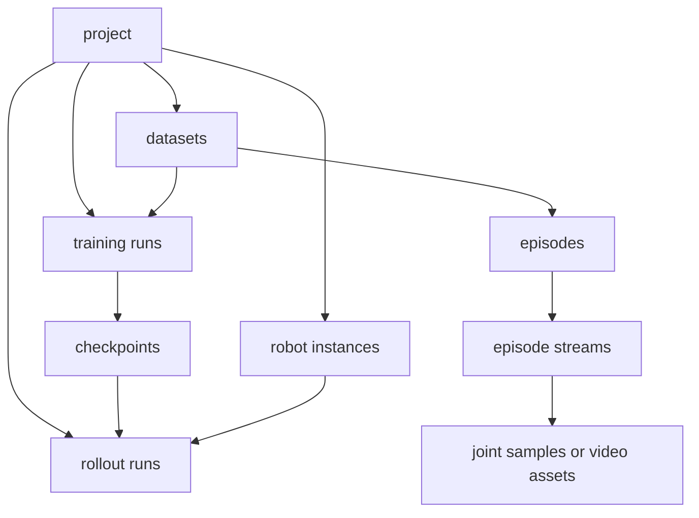

# SpiralDB persistence and schema

## Outcome

SpiralDB provides one durable relational model for the complete application.
The product does not reconcile a second local source of truth.

## Durable ownership

- **PERSIST-001** SpiralDB must be the only durable application data store.
- **PERSIST-002** Projects must own robots, datasets, training runs, and rollout
  runs.
- **PERSIST-003** Datasets must own episodes.
- **PERSIST-004** Episodes must own stream declarations and stream data.
- **PERSIST-005** Training runs must own checkpoints.
- **PERSIST-006** Rollout runs must identify their checkpoint and follower.
- **PERSIST-007** Robot definitions, motor assignments, camera assignments, and
  calibrations must be durable relations.
- **PERSIST-008** The production system must not treat a local robot workspace
  or episode directory as another source of truth.
- **PERSIST-009** The system must not use a durable local spool or application
  data buffer when SpiralDB is unavailable.
- **PERSIST-010** Browser panel layouts must remain session state; Studio must
  not create a second durable browser store for them.
- **PERSIST-011** Studio must not use a persistent local cache for project data
  or model artifacts.
- **PERSIST-012** Live compute jobs may stay in worker memory, but their
  checkpoints must be written directly to SpiralDB and Studio must be able to
  reattach by stable job ID.
- **PERSIST-013** Studio must start when no Spiral project is selected. Settings
  must let the operator configure both the Spiral control-plane API endpoint
  and the SpFS endpoint, then select and test the active project. Project
  switches must drain repository work, discard stale pooled connections, and
  be refused while recording, replay, rollout, training, active motor control,
  or a catalog-visible robot connection is active. When the old catalog is
  unavailable, idle released hardware connections that cannot be represented
  in Settings must be disconnected during the cutover rather than trapping the
  operator on the unavailable destination. Endpoint, project, client ID, and
  client-secret changes must create a new database with scoped ADBC options and
  apply live after the old pool drains; they must not mutate process-global
  environment variables or require a Studio restart. The namespace remains
  process bootstrap configuration, and
  individual domain operations must not accept or reconstruct alternate
  destinations.
- **PERSIST-014** Stored SpiralDB credentials must remain in the backend and
  must not be returned to the browser.

## Relational shape

- **PERSIST-015** Relations must use stable semantic IDs for ownership.
- **PERSIST-016** The episode relation must include identity, sample rate, frame
  count, duration, and discarded state.
- **PERSIST-017** The joint-sample relation must include episode, stream, sample
  index, episode time, state, and optional action, velocity, and effort.
- **PERSIST-018** SO-ARM101 state and action vectors must contain six ordered
  joint values.
- **PERSIST-019** The video-source relation must include episode, camera role,
  segment index, timeline bounds, media, dimensions, and frame rate.
- **PERSIST-020** SpiralDB must expose video sources through exactly one managed
  MP4 dataset per active Studio namespace. One shared source view must read the
  namespace's complete `video_assets` relation, and the managed output must
  preserve episode, stream, and segment keys so consumers filter media rows
  without creating per-episode views or datasets.
- **PERSIST-021** A query for one episode and camera-frame index must return the
  matching joint vector and an image tensor shaped as height, width, and three
  color channels.
- **PERSIST-022** Persisted vectors must use typed Arrow-compatible columns, not
  JSON strings.
- **PERSIST-023** Table names, column names, and SQL value encoding must be
  centralized at the Spiral persistence boundary.
- **PERSIST-024** Product storage must preserve real table semantics for
  [SQL Query](query.md).

## Portable transfer files

- **PERSIST-025** Studio must export every Studio-owned relation in the active
  SpiralDB namespace as one `.spiral-project` file.
- **PERSIST-026** The portable file must carry a versioned manifest and typed
  Arrow IPC payload for each included relation.
- **PERSIST-027** Import must validate the file format, schema version, relation
  names, and exact ordered columns before replacing project data.
- **PERSIST-028** Import must replace the active project in one exclusive
  transaction and roll back on failure. Each included relation must be installed
  from its single Arrow stream with ADBC `Replace`; Studio must not clear an
  included relation with `DELETE` and then append its replacement rows.
  Incremental episode import and live recording remain create-append operations.
  Studio-owned relations absent from the file must be removed, and import must
  not stage through the local filesystem. Before the exclusive
  operation returns, imported video assets must be retargeted to the active
  namespace and its single managed MP4 dataset must be created or refreshed
  once from all committed durable rows. The shared dataset and source view must
  be removed when the imported project has no video assets. Studio must never
  create or refresh per-episode video views or datasets.
  Derived-resource reconciliation happens after the relational commit because
  newly ingested relations are not bindable before publication. A repair
  failure must therefore return a successful committed-row summary with an
  explicit warning; it must never report the durable import as rolled back.
  If restoring autocommit after a successful commit fails, Studio must likewise
  return the committed summary with a warning and discard the uncertain
  connection rather than returning it to the pool.
- **PERSIST-029** Whole-project import must disconnect every connected robot
  before replacing project data and must stop without importing if a robot
  cannot be safely disconnected. After a successful replacement it must
  automatically try to connect every usable imported robot independently.
  Episode import must still be refused while any robot is connected. Both
  import paths must be refused while recording, replay, rollout, training, or
  another catalog mutation is active.
- **PERSIST-030** Project transfer may use one bounded in-memory
  request/response buffer, currently limited to 256 MiB; that buffer is not
  durable storage. HTTP import must move the received buffer into storage work
  without cloning the entire archive. Import must bind all Arrow record batches
  for one relation as one ADBC stream rather than executing one ingest per IPC
  batch.
- **PERSIST-031** One private backend-local JSON file may persist only the
  bootstrap state needed before Spiral can be opened: the API endpoint, SpFS
  endpoint, selected project ID, and optional client ID and client secret. It
  must use atomic replacement and private
  permissions and must never contain robots, episodes, media, runs,
  checkpoints, project preferences, a write spool, or cached Spiral rows.
- **PERSIST-032** Whole-project import and export must live in Settings →
  SpiralDB, separate from episode transfer in Data.
- **PERSIST-033** Data must export the selected dataset's metadata, episodes,
  stream declarations, joint samples, and video assets as one versioned
  `.spiral-episodes` file. It must exclude project-level relations.
- **PERSIST-034** Episode import must target the selected dataset. It must keep
  an existing target dataset's metadata, retarget imported episode rows to the
  target, and merge the imported episode-owned relations transactionally.
- **PERSIST-035** Episode import must validate its manifest, schema, exact
  relation columns, single source dataset, episode IDs, and child references
  before writing. It must refuse any episode ID that already exists in the
  project and never replace an existing episode.
- **PERSIST-036** `.spiral-project` and `.spiral-episodes` must have distinct
  format identities and must not be accepted by the other's import path.
- **PERSIST-037** The synchronous ADBC API must remain private to the shared
  Spiral repository adapter. During active co-development, the Studio backend
  must link the native `adbc-driver-spiraldb` Rust crate from SpiralDB's
  `develop` branch through Cargo's Git source at the revision pinned by
  `Cargo.lock`. Standard CI must use selected-package dependency resolution to
  exclude the native backend until a separate SpiralDB integration lane
  exists; it must not fetch the private driver or connect to SpiralDB, SpFS, or
  a disposable hosted project. Studio must construct the native driver
  directly; it must not accept a driver-library
  path, use an ADBC driver manager, or load the Spiral driver
  dynamically. For each active project, the adapter must own one native
  database/engine runtime, expose only repository-owned connection and
  statement operations, run asynchronous calls on bounded blocking workers,
  and apply the same fixed connection limit to ordinary, long-lived,
  exclusive, invalidating, and synchronous-worker checkouts. No domain or
  delivery module may construct an ADBC database or bypass that capacity gate.
  Non-Rust workers may continue to use the language-neutral ADBC shared library.
- **PERSIST-038** After the HTTP listener binds, Studio must prewarm the active
  project's authenticated catalog through the same shared ADBC pool used by
  ordinary repository work. Only after that succeeds may it hydrate
  project-owned preferences and run history, and those independent loads must
  run concurrently on bounded blocking workers rather than delaying listener
  startup or occupying async executor threads.
- **PERSIST-039** The current relational schema version must be generated from
  the shared machine-readable boundary descriptor. External workers must
  receive the selected version through their request boundary and must not
  maintain a copied schema-version literal.
- **PERSIST-040** `video_assets.payload` must be the `spql.io.Blob` Arrow
  extension, not an Arrow Binary column. Native Spiral table writes must own
  Blob outlining and provider placement, and the shared MP4 source view must
  forward that Blob without wrapping a materialized Binary value. Portable
  project and episode exports must deliberately materialize Blob bytes into
  their bounded Arrow IPC payloads; import must normalize both those payloads
  and legacy Binary payloads back to the canonical Blob type before ingest.
  Catalog startup and destination changes must migrate a legacy Binary
  `video_assets` relation before the destination is considered ready.

## Schema changes

- **MIGRATE-001** Persistence must use a small Rust abstraction for SQL, typed
  Arrow mapping, and migrations. It must not require an ORM.
- **MIGRATE-002** Migrations must be ordered, checksummed, and recorded in a
  `schema_migrations` relation.
- **MIGRATE-003** Durable product relations must use the SpiralDB Arbor engine.
- **MIGRATE-004** A migration must inspect the current schema before applying a
  change.
- **MIGRATE-005** A risky migration must use expand, backfill, verify, and
  cutover phases.
- **MIGRATE-006** A schema mismatch must produce an actionable error instead of
  a hidden compatibility workaround.
- **MIGRATE-007** When a SpiralDB or Arbor defect blocks the correct design, the
  project must stop and fix or raise the upstream defect.

## Testability

- **PERSIST-TEST-001** Persistent adapters must converge on one shared
  `SpiralRepository`; ADBC is the physical persistence boundary.
- **PERSIST-TEST-002** Pure application-policy tests may use capability fakes,
  but Studio must not ship a simulated persistence backend or an in-memory
  ADBC destination mode.
- **PERSIST-TEST-003** SpiralDB integration tests must use the real adapter for
  relational and video behavior.
- **PERSIST-TEST-004** A real-SpiralDB project-transfer test must export a
  namespace containing relational JSON and binary checkpoint data, replace it
  with conflicting data, import the exported bundle, and prove that the
  exported state is restored exactly. Relations and rows created only after
  export must be absent after import. A real-SpiralDB video-transfer regression
  must also begin with only durable MP4 rows, prove import rebuilds the managed
  MP4 output and can read an indexed frame, then re-import the same project and
  prove the output is atomically replaced rather than rejected or duplicated.
  Its MP4 fixture must exceed Spiral's inline-Blob threshold and prove the
  imported payload has a provider URI and that `spql.io.read_bytes` returns an
  exact requested byte slice.
- **PERSIST-TEST-005** A real-SpiralDB episode-transfer test must export one
  dataset, import it into an existing target dataset, prove the target's prior
  episodes survive and imported rows are retargeted, and prove a repeated
  import is refused rather than overwriting an episode.
- **PERSIST-TEST-006** Architecture tests must prove that raw ADBC types occur
  only in the shared repository adapter, that Studio uses the native SpiralDB
  driver crate rather than the driver manager, and that every repository
  checkout mode consumes its one capacity gate. A concurrency test must prove
  a synchronous worker waits while the same gate is occupied asynchronously.

## Implementation ownership

- Stable relation names:
  [`spiral-robotics-contracts/src/spiral.rs`](../../crates/spiral-robotics-contracts/src/spiral.rs)
- Shared ADBC repository, query, and transfer formats:
  [`backend/storage`](../../crates/spiral-robotics-studio-backend/src/backend/storage/)
- Episode relation encoding:
  [`backend/recording/spiral.rs`](../../crates/spiral-robotics-studio-backend/src/backend/recording/spiral.rs)

## Current gap

Ordered checksummed `schema_migrations` are not implemented yet. The current
adapter rejects project files with a different schema version; this does not
redefine the accepted migration behavior above.
