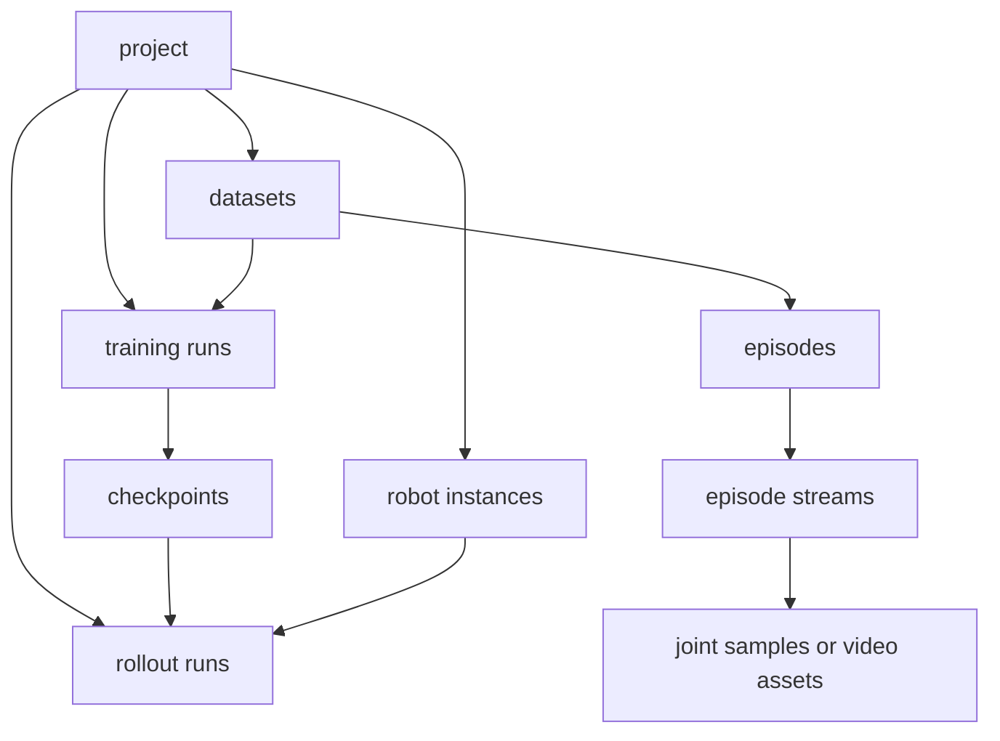

# SpiralDB persistence and schema

## Outcome

SpiralDB provides one durable relational model for the complete application.
The product does not reconcile a second local source of truth.

## Durable ownership

- **PERSIST-001** SpiralDB must be the only durable application data store.
- **PERSIST-002** Projects must own robots, datasets, training runs, and rollout
  runs.
- **PERSIST-003** Datasets must own episodes.
- **PERSIST-004** Episodes must own stream declarations and stream data.
- **PERSIST-005** Training runs must own checkpoints.
- **PERSIST-006** Rollout runs must identify their checkpoint and follower.
- **PERSIST-007** Robot definitions, motor assignments, camera assignments, and
  calibrations must be durable relations.
- **PERSIST-008** The production system must not treat a local robot workspace
  or episode directory as another source of truth.
- **PERSIST-009** The system must not use a durable local spool or application
  data buffer when SpiralDB is unavailable.
- **PERSIST-010** Browser panel layouts may remain local.
- **PERSIST-011** Downloaded pretrained model files may use a rebuildable local
  cache.
- **PERSIST-012** Compute sessions may stay in memory because Studio owns their
  durable results.
- **PERSIST-013** Settings must let the user configure and test the SpiralDB
  destination.
- **PERSIST-014** Stored SpiralDB credentials must remain in the backend and
  must not be returned to the browser.

## Relational shape

- **PERSIST-015** Relations must use stable semantic IDs for ownership.
- **PERSIST-016** The episode relation must include identity, sample rate, frame
  count, duration, and discarded state.
- **PERSIST-017** The joint-sample relation must include episode, stream, sample
  index, episode time, state, and optional action, velocity, and effort.
- **PERSIST-018** SO-ARM101 state and action vectors must contain six ordered
  joint values.
- **PERSIST-019** The video-source relation must include episode, camera role,
  segment index, timeline bounds, media, dimensions, and frame rate.
- **PERSIST-020** SpiralDB must expose video sources through its MP4 dataset
  capability.
- **PERSIST-021** A query for one episode and camera-frame index must return the
  matching joint vector and an image tensor shaped as height, width, and three
  color channels.
- **PERSIST-022** Persisted vectors must use typed Arrow-compatible columns, not
  JSON strings.
- **PERSIST-023** Table and column names must be centralized.
- **PERSIST-024** Product storage must preserve real table semantics for
  [SQL Query](query.md).

The confirmed SQL example remains in the
[SpiralDB section of `notes.md`](../../notes.md#spiraldb).

## Schema changes

- **MIGRATE-001** Persistence must use a small Rust abstraction for SQL, typed
  Arrow mapping, and migrations. It must not require an ORM.
- **MIGRATE-002** Migrations must be ordered, checksummed, and recorded in a
  `schema_migrations` relation.
- **MIGRATE-003** Durable product relations must use the SpiralDB Arbor engine.
- **MIGRATE-004** A migration must inspect the current schema before applying a
  change.
- **MIGRATE-005** A risky migration must use expand, backfill, verify, and
  cutover phases.
- **MIGRATE-006** A schema mismatch must produce an actionable error instead of
  a hidden compatibility workaround.
- **MIGRATE-007** When a SpiralDB or Arbor defect blocks the correct design, the
  project must stop and fix or raise the upstream defect.

## Testability

- **PERSIST-TEST-001** Application features must use storage ports instead of an
  ADBC driver directly.
- **PERSIST-TEST-002** Feature tests may use an in-memory fake that preserves the
  product semantics needed by the use case.
- **PERSIST-TEST-003** The fake does not need to reproduce SpiralDB internals
  such as MP4 decoding.
- **PERSIST-TEST-004** SpiralDB integration tests must use the real adapter for
  relational and video behavior.

## Implementation ownership

- Stable relation names:
  [`spiral-robotics-contracts/src/spiral.rs`](../../crates/spiral-robotics-contracts/src/spiral.rs)
- Current ADBC, query, and publication adapter:
  [`backend/storage`](../../crates/spiral-robotics-studio-backend/src/backend/storage/)
- Episode relation encoding:
  [`backend/recording/spiral.rs`](../../crates/spiral-robotics-studio-backend/src/backend/recording/spiral.rs)

## Current gaps

The current working tree does not yet conform to SpiralDB-only durability:

- robot instances still use JSON files in
  [`backend/robots/workspace.rs`](../../crates/spiral-robotics-studio-backend/src/backend/robots/workspace.rs);
- episodes and video still use local files in
  [`backend/recording`](../../crates/spiral-robotics-studio-backend/src/backend/recording/);
- local episode files remain the publication recovery boundary in
  [`backend/storage/manager.rs`](../../crates/spiral-robotics-studio-backend/src/backend/storage/manager.rs);
- service settings still use a local file in
  [`backend/storage/settings.rs`](../../crates/spiral-robotics-studio-backend/src/backend/storage/settings.rs);
- ordered checksummed `schema_migrations` are not implemented;
- the project-owned relations for robots, calibration, training runs, and
  rollout runs are incomplete.

These are implementation gaps. They do not redefine the accepted persistence
behavior.
