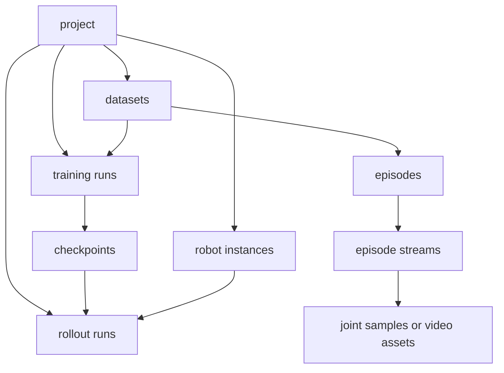

# SpiralDB persistence and schema

## Outcome

SpiralDB provides one durable relational model for the complete application.
The product does not reconcile a second local source of truth.

## Durable ownership

- **PERSIST-001** SpiralDB must be the only durable application data store.
- **PERSIST-002** Projects must own robots, datasets, training runs, and rollout
  runs.
- **PERSIST-003** Datasets must own episodes.
- **PERSIST-004** Episodes must own stream declarations and stream data.
- **PERSIST-005** Training runs must own checkpoints.
- **PERSIST-006** Rollout runs must identify their checkpoint and follower.
- **PERSIST-007** Robot definitions, motor assignments, camera assignments, and
  calibrations must be durable relations.
- **PERSIST-008** The production system must not treat a local robot workspace
  or episode directory as another source of truth.
- **PERSIST-009** The system must not use a durable local spool or application
  data buffer when SpiralDB is unavailable.
- **PERSIST-010** Browser panel layouts must remain session state; Studio must
  not create a second durable browser store for them.
- **PERSIST-011** Studio must not use a persistent local cache for project data
  or model artifacts.
- **PERSIST-012** Compute sessions may stay in memory because Studio owns their
  durable results.
- **PERSIST-013** Studio must start when no Spiral project is selected. Settings
  must let the operator configure both the Spiral control-plane API endpoint
  and the SpFS endpoint, then select and test the active project. Project
  switches must drain repository work, discard stale pooled connections, and
  be refused while robots or project activity are active. Because the ADBC
  driver binds both service endpoints when constructing a database, changing
  either endpoint must save the complete next destination, clearly require a
  Studio restart, and must not send project data to the still-active old
  destination. The namespace remains process bootstrap configuration, and
  individual domain operations must not accept or reconstruct alternate
  destinations.
- **PERSIST-014** Stored SpiralDB credentials must remain in the backend and
  must not be returned to the browser.

## Relational shape

- **PERSIST-015** Relations must use stable semantic IDs for ownership.
- **PERSIST-016** The episode relation must include identity, sample rate, frame
  count, duration, and discarded state.
- **PERSIST-017** The joint-sample relation must include episode, stream, sample
  index, episode time, state, and optional action, velocity, and effort.
- **PERSIST-018** SO-ARM101 state and action vectors must contain six ordered
  joint values.
- **PERSIST-019** The video-source relation must include episode, camera role,
  segment index, timeline bounds, media, dimensions, and frame rate.
- **PERSIST-020** SpiralDB must expose video sources through its MP4 dataset
  capability.
- **PERSIST-021** A query for one episode and camera-frame index must return the
  matching joint vector and an image tensor shaped as height, width, and three
  color channels.
- **PERSIST-022** Persisted vectors must use typed Arrow-compatible columns, not
  JSON strings.
- **PERSIST-023** Table names, column names, and SQL value encoding must be
  centralized at the Spiral persistence boundary.
- **PERSIST-024** Product storage must preserve real table semantics for
  [SQL Query](query.md).

## Portable transfer files

- **PERSIST-025** Studio must export every Studio-owned relation in the active
  SpiralDB namespace as one `.spiral-project` file.
- **PERSIST-026** The portable file must carry a versioned manifest and typed
  Arrow IPC payload for each included relation.
- **PERSIST-027** Import must validate the file format, schema version, relation
  names, and exact ordered columns before replacing project data.
- **PERSIST-028** Import must replace the active project in one exclusive
  transaction and roll back on failure. Rows in included relations must be
  replaced, Studio-owned relations absent from the file must be removed, and
  import must not stage through the local filesystem.
- **PERSIST-029** Import must be refused while robots are connected or recording,
  replay, rollout, training, or another catalog mutation is active.
- **PERSIST-030** Project transfer may use a bounded in-memory request/response
  buffer, currently limited to 1 GiB; that buffer is not durable storage.
- **PERSIST-031** One private backend-local JSON file may persist only the
  bootstrap state needed before Spiral can be opened, currently the API
  endpoint, SpFS endpoint, selected project ID, and, when implemented,
  authentication/session metadata. It must use atomic replacement and private
  permissions and must never contain robots, episodes, media, runs,
  checkpoints, project preferences, a write spool, or cached Spiral rows.
- **PERSIST-032** Whole-project import and export must live in Settings →
  SpiralDB, separate from episode transfer in Data.
- **PERSIST-033** Data must export the selected dataset's metadata, episodes,
  stream declarations, joint samples, and video assets as one versioned
  `.spiral-episodes` file. It must exclude project-level relations.
- **PERSIST-034** Episode import must target the selected dataset. It must keep
  an existing target dataset's metadata, retarget imported episode rows to the
  target, and merge the imported episode-owned relations transactionally.
- **PERSIST-035** Episode import must validate its manifest, schema, exact
  relation columns, single source dataset, episode IDs, and child references
  before writing. It must refuse any episode ID that already exists in the
  project and never replace an existing episode.
- **PERSIST-036** `.spiral-project` and `.spiral-episodes` must have distinct
  format identities and must not be accepted by the other's import path.

The confirmed SQL example remains in the
[SpiralDB section of `notes.md`](../../notes.md#spiraldb).

## Schema changes

- **MIGRATE-001** Persistence must use a small Rust abstraction for SQL, typed
  Arrow mapping, and migrations. It must not require an ORM.
- **MIGRATE-002** Migrations must be ordered, checksummed, and recorded in a
  `schema_migrations` relation.
- **MIGRATE-003** Durable product relations must use the SpiralDB Arbor engine.
- **MIGRATE-004** A migration must inspect the current schema before applying a
  change.
- **MIGRATE-005** A risky migration must use expand, backfill, verify, and
  cutover phases.
- **MIGRATE-006** A schema mismatch must produce an actionable error instead of
  a hidden compatibility workaround.
- **MIGRATE-007** When a SpiralDB or Arbor defect blocks the correct design, the
  project must stop and fix or raise the upstream defect.

## Testability

- **PERSIST-TEST-001** Persistent adapters must converge on one shared
  `SpiralRepository`; ADBC is the physical persistence boundary.
- **PERSIST-TEST-002** Pure application-policy tests may use capability fakes,
  but Studio must not ship a simulated persistence backend or an in-memory
  ADBC destination mode.
- **PERSIST-TEST-003** SpiralDB integration tests must use the real adapter for
  relational and video behavior.
- **PERSIST-TEST-004** A real-SpiralDB project-transfer test must export a
  namespace containing relational JSON and binary checkpoint data, replace it
  with conflicting data, import the exported bundle, and prove that the
  exported state is restored exactly. Relations and rows created only after
  export must be absent after import.
- **PERSIST-TEST-005** A real-SpiralDB episode-transfer test must export one
  dataset, import it into an existing target dataset, prove the target's prior
  episodes survive and imported rows are retargeted, and prove a repeated
  import is refused rather than overwriting an episode.

## Implementation ownership

- Stable relation names:
  [`spiral-robotics-contracts/src/spiral.rs`](../../crates/spiral-robotics-contracts/src/spiral.rs)
- Shared ADBC repository, query, and transfer formats:
  [`backend/storage`](../../crates/spiral-robotics-studio-backend/src/backend/storage/)
- Episode relation encoding:
  [`backend/recording/spiral.rs`](../../crates/spiral-robotics-studio-backend/src/backend/recording/spiral.rs)

## Current gap

Ordered checksummed `schema_migrations` are not implemented yet. The current
adapter rejects project files with a different schema version; this does not
redefine the accepted migration behavior above.
