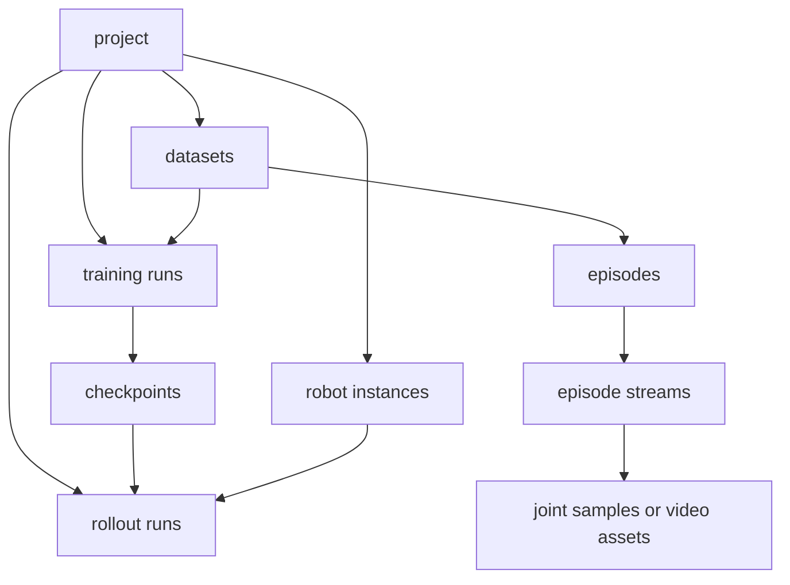

# SpiralDB persistence and schema

## Outcome

SpiralDB provides one durable relational model for Studio product data.
The product does not reconcile a second local source of truth.

## Durable ownership

- **PERSIST-001** SpiralDB must be the only durable Studio product-data store.
- **PERSIST-002** Projects must own robots, datasets, training runs, and rollout
  runs.
- **PERSIST-003** Datasets must own episodes.
- **PERSIST-004** Episodes must own stream declarations and stream data.
- **PERSIST-005** Training runs must own checkpoints.
- **PERSIST-006** Rollout runs must identify their checkpoint and follower.
- **PERSIST-007** Robot definitions, motor assignments, camera assignments, and
  calibrations must be durable relations.
- **PERSIST-008** The production system must not treat a local robot workspace
  or episode directory as another source of truth.
- **PERSIST-009** The system must not use a durable local spool or buffer for
  product data when SpiralDB is unavailable.
- **PERSIST-010** Browser panel layouts must remain session state; Studio must
  not create a second durable browser store for them.
- **PERSIST-011** Studio must not use a persistent local cache for project data
  or model artifacts.
- **PERSIST-012** Live compute jobs may stay in worker memory, but their
  checkpoints must be written directly to SpiralDB and Studio must be able to
  reattach by stable job ID.
- **PERSIST-013** Studio must start when no Spiral project is selected. Settings
  must let the operator configure both the Spiral control-plane API endpoint
  and the SpFS endpoint, then select and test the active project. Project
  switches must drain project-store work, retire the prior native session, and
  be refused while recording, replay, rollout, training, active motor control,
  or a catalog-visible robot connection is active. When the old catalog is
  unavailable, idle released hardware connections that cannot be represented
  in Settings must be disconnected during the cutover rather than trapping the
  operator on the unavailable destination. Endpoint, project, client ID, and
  client-secret changes must create a new native database session with scoped
  client options and apply live after old work drains; they must not mutate process-global
  environment variables or require a Studio restart. The namespace remains
  process bootstrap configuration, and
  individual domain operations must not accept or reconstruct alternate
  destinations. Settings → SpiralDB is the only flow allowed to create the
  Studio-managed namespace or its relations. Testing the active connection
  must verify connectivity and the complete managed relation set, create the
  namespace and every missing managed relation from its statically declared
  Arrow schema, and report whether all relations were already present or name
  every relation it created. Installing a changed destination must install the
  new scoped connection, run the same provisioning and Binary-to-Blob
  readiness work, and only then write project-owned preferences through it.
- **PERSIST-014** Stored SpiralDB credentials must remain in the backend and
  must not be returned to the browser.

## Relational shape

- **PERSIST-015** Relations must use stable semantic IDs for ownership.
- **PERSIST-016** The episode relation must include identity, sample rate, frame
  count, duration, discarded state, and the intervals omitted from its timeline.
- **PERSIST-017** The joint-sample relation must include episode, stream, sample
  index, episode time, state, and optional action, velocity, and effort.
- **PERSIST-018** SO-ARM101 state and action vectors must contain six ordered
  joint values.
- **PERSIST-019** The video-source relation must include episode, camera role,
  segment index, timeline bounds, media, dimensions, and frame rate.
- **PERSIST-020** SpiralDB must expose video sources through exactly one managed
  MP4 dataset per active Studio namespace. One shared source view must read the
  namespace's complete `video_assets` relation, and the managed output must
  preserve episode, stream, and segment keys so consumers filter media rows
  without creating per-episode views or datasets.
- **PERSIST-021** A query for one episode and camera-frame index must return the
  matching joint vector and an image tensor shaped as height, width, and three
  color channels.
- **PERSIST-022** Persisted vectors must use typed Arrow-compatible columns, not
  JSON strings.
- **PERSIST-022a** Training-run and rollout history must be relations of typed
  rows owned by the storage crate, never a serialized Studio wire type. The
  training run relation must carry each retained run's identity, selected
  dataset, policy configuration, optimizer schedule, and lifecycle; its metric
  and checkpoint rows must live in child relations keyed by `run_id`; and one
  rollout row must record the latest policy session keyed by `session_id`.
  Every persisted enumeration spelling must be declared by storage and mapped
  at the backend boundary.
- **PERSIST-022b** A persisted document that is not yet decomposed into
  relations must declare the version of its encoding in its own column. A
  reader that meets a version it does not implement must refuse it with an
  actionable error and must not modify the operator's document. Only a payload
  of a known version that no longer parses may fall back to an empty document.
- **PERSIST-022c** Nothing persisted under an episode may be a serialized
  Studio wire type. An episode's arms, per-joint motor condition, and recording
  gaps must be typed columns of the episode and episode-stream relations, and
  the stream relation must fix each arm's frame order rather than relying on
  physical row order. A pre-schema-8 episode relation is not decoded or
  migrated.
- **PERSIST-022d** A reader that encounters a legacy storage format it does not
  implement must refuse it with an actionable error telling the operator to
  start a fresh project. Detection must never modify, delete, hide, or replace
  the stored data. Episode catalog failures must use the catalog issues channel;
  training, rollout, and Workflow failures must use their hydration error
  paths, leaving current-format projects fully usable.
- **PERSIST-023** Table names, column names, and SQL value encoding must be
  centralized at the Spiral persistence boundary.
- **PERSIST-024** Product storage must preserve real table semantics for
  [SQL Query](query.md).
- **PERSIST-024a** Outside Settings → SpiralDB destination provisioning, every
  Studio reader and writer must assume the complete managed relation set
  exists with its compile-time schema. A missing managed relation must be an
  actionable error that identifies the missing target; it must never become an
  empty/default read, a skipped operation, or lazy relation creation. Ordinary
  appends and replacements must require an existing relation. Derived MP4
  resources, the Workflow feature registry and feature caches, and
  legacy-format schema inspection retain their explicit dynamic lifecycles.

## Portable transfer files

- **PERSIST-025** Studio must export every Studio-owned relation in the active
  SpiralDB namespace as one `.spiral-project` file.
- **PERSIST-026** The portable file must carry a versioned manifest and typed
  Arrow IPC payload for each included relation.
- **PERSIST-027** Import must validate the file format, schema version, relation
  names, and exact ordered columns before replacing project data.
- **PERSIST-028** Import must replace the active project in one exclusive
  transaction and roll back on failure. Each included relation must be installed
  from its single Arrow stream with native existing-relation `Replace`
  ingestion; Studio must not clear an included relation with `DELETE` and then
  append its replacement rows. Incremental episode import and live recording
  append only to provisioned relations. A Studio-owned relation absent from
  the file must be replaced with an empty relation using its statically
  declared schema, never dropped or created by import. Import must not stage
  through the local filesystem. Before the exclusive
  operation returns, imported video assets must be retargeted to the active
  namespace and its single managed MP4 dataset must be created or refreshed
  once from all committed durable rows. The shared dataset and source view must
  be removed when the imported project has no video assets. Studio must never
  create or refresh per-episode video views or datasets.
  Derived-resource reconciliation happens after the relational commit because
  newly ingested relations are not bindable before publication. A repair
  failure must therefore return a successful committed-row summary with an
  explicit warning; it must never report the durable import as rolled back.
  Commit and rollback are terminal transaction operations. Import must open a
  fresh logical connection under the same exclusive project lease before
  derived-resource reconciliation. If that post-commit connection cannot be
  opened, Studio must return the committed summary with an explicit warning
  and skip reconciliation rather than misreporting the durable commit as
  uncertain.
- **PERSIST-029** Whole-project import must disconnect every connected robot
  before replacing project data and must stop without importing if a robot
  cannot be safely disconnected. After a successful replacement it must
  automatically try to connect every usable imported robot independently.
  Episode import must still be refused while any robot is connected. Both
  import paths must be refused while recording, replay, rollout, training, or
  another catalog mutation is active.
- **PERSIST-030** Project transfer may use one bounded in-memory
  request/response buffer, currently limited to 256 MiB; that buffer is not
  durable storage. HTTP import must move the received buffer into storage work
  without cloning the entire archive. Import must bind all Arrow record batches
  for one relation as one native Arrow stream rather than executing one ingest per IPC
  batch. Before decoding, import must enforce that the cumulative declared
  decoded Arrow buffers fit the same bound, including compressed buffers at
  their declared decompressed sizes. It must not reject an otherwise bounded
  stream by counting one shared IPC message-body allocation once per column
  slice.
- **PERSIST-031** One private backend-local JSON file may persist only the
  bootstrap state needed before Spiral can be opened: the API endpoint, SpFS
  endpoint, selected project ID, and optional client ID and client secret. It
  must use atomic replacement and private
  permissions and must never contain robots, episodes, media, runs,
  checkpoints, project preferences, a write spool, or cached Spiral rows. A
  live destination switch must drain and install the requested scoped
  connection before writing project-owned preferences or committing this
  bootstrap file, so recovery never depends on the previous project's catalog
  remaining available. A new-destination preference or bootstrap-write failure
  must restore the previous in-memory connection.
- **PERSIST-032** Whole-project import and export must live in Settings →
  SpiralDB, separate from episode transfer in Data.
- **PERSIST-033** Data must export the selected dataset's metadata, episodes,
  stream declarations, joint samples, and video assets as one versioned
  `.spiral-episodes` file. It must exclude project-level relations.
- **PERSIST-034** Episode import must target the selected dataset. It must keep
  an existing target dataset's metadata, retarget imported episode rows to the
  target, and merge the imported episode-owned relations transactionally.
- **PERSIST-035** Episode import must validate its manifest, schema, exact
  relation columns, single source dataset, episode IDs, and child references
  before writing. It must refuse any episode ID that already exists in the
  project and never replace an existing episode.
- **PERSIST-036** `.spiral-project` and `.spiral-episodes` must have distinct
  format identities and must not be accepted by the other's import path.
- **PERSIST-037** The Studio backend must use SpiralDB's native asynchronous
  Rust APIs through a storage-owned database trait. The trait must expose
  logical connections, explicit transactions, schema/catalog inspection, one
  unified SQL-or-Arrow command, record streams, update summaries, and typed
  errors without exposing Spiral engine or Vortex types. Native `ConnectionCtx`
  values and their futures must be `Send` and owned directly by the logical
  connection implementation; the adapter must not add local-executor tasks,
  request channels, or proxy state machines. Axum and Vortex execution share
  the server's Tokio runtime, while Vortex CPU work may use that runtime's
  worker pool.
  Every backend persistence path, including recording finalization, import,
  project transfer, Workflow publication, Training, Rollout, and robot
  configuration, must await the database trait directly. The project store
  must not expose an async-to-sync compatibility wrapper or run database
  futures through `block_on` or a blocking worker. CPU-bound model inference,
  media encoding, hardware I/O, and synchronous external SDK calls may use
  dedicated threads or Tokio's blocking pool, but database access before and
  after that work remains async. The project connection must expose explicit
  begin, consuming commit/rollback, and intentional post-commit reconnection;
  it must not retain an ADBC-style `set_autocommit` compatibility surface.
  Native
  logical connections must not be constrained by an arbitrary application
  semaphore; each connection directly owns its own stateful operations.
  Spiral and Vortex crates must resolve to revisions already pinned in
  `Cargo.lock`; this change must not introduce another Spiral-related package.
  The Rust backend must not depend on an ADBC crate or accept a driver-library
  path. Non-Rust workers may continue to use the language-neutral ADBC shared
  library.
- **PERSIST-038** After the HTTP listener binds, Studio must prewarm the active
  project's authenticated catalog through the same native async database trait
  used by ordinary project-store work. Only after that succeeds may it hydrate
  project-owned preferences and run history, and those independent loads must
  run concurrently rather than delaying listener startup. Prewarm must verify
  the managed namespace and complete relation set without creating anything.
  If either is missing, startup must degrade with an actionable instruction to
  run Settings → SpiralDB → Test connection. The PERSIST-040
  Binary-to-Blob migration remains destination-readiness work and may run only
  after the managed relation set has passed that verification.
- **PERSIST-039** The storage crate must own the current relational schema in a
  machine-readable version file beside its schema implementation and
  changelog. Rust consumers must generate their constant from that file.
  External workers must package the same file, receive the selected version
  through their request protocol, and must not maintain a copied
  schema-version literal.
- **PERSIST-040** `video_assets.payload` must be the `spql.io.Blob` Arrow
  extension, not an Arrow Binary column. Native Spiral table writes must own
  Blob outlining and provider placement, and the shared MP4 source view must
  forward that Blob without wrapping a materialized Binary value. Portable
  project and episode exports must deliberately materialize Blob bytes into
  their bounded Arrow IPC payloads; import must accept that portable binary
  field as nullable or required and normalize Binary, LargeBinary, or
  BinaryView payloads back to the canonical Blob type before ingest, while
  still rejecting a null payload value.
  Catalog startup and destination changes must migrate a legacy Binary
  `video_assets` relation before the destination is considered ready.

## Schema changes

- **MIGRATE-001** Persistence must use a small Rust abstraction for SQL, typed
  Arrow mapping, and migrations. It must not require an ORM.
- **MIGRATE-002** Migrations must be ordered, checksummed, and recorded in a
  `schema_migrations` relation.
- **MIGRATE-003** Durable product relations must use the SpiralDB Arbor engine.
- **MIGRATE-004** A migration must inspect the current schema before applying a
  change.
- **MIGRATE-005** A risky migration must use expand, backfill, verify, and
  cutover phases.
- **MIGRATE-006** A schema mismatch must produce an actionable error instead of
  a hidden compatibility workaround.
- **MIGRATE-007** When a SpiralDB or Arbor defect blocks the correct design, the
  project must stop and fix or raise the upstream defect.

## Testability

- **PERSIST-TEST-001** Persistent adapters must converge on one shared
  `ProjectStore`; the native Spiral adapter is the physical persistence
  boundary and the async database trait is the application-facing boundary.
- **PERSIST-TEST-002** Pure backend-capability tests may use capability fakes,
  but Studio must not ship a simulated persistence backend or an in-memory
  persistence destination mode.
- **PERSIST-TEST-003** SpiralDB integration tests must use the real adapter for
  relational and video behavior.
- **PERSIST-TEST-004** A real-SpiralDB project-transfer test must export a
  namespace containing relational JSON and binary checkpoint data, replace it
  with conflicting data, import the exported bundle, and prove that the
  exported state is restored exactly. Rows created only after export must be
  absent after import, while every managed relation must remain present and a
  relation omitted from the imported file must be empty. A real-SpiralDB
  video-transfer regression must also begin with only durable MP4 rows, prove
  import rebuilds the managed MP4 output and can read an indexed frame, then
  re-import the same project and prove the output is atomically replaced rather
  than rejected or duplicated.
  Its MP4 fixture must exceed Spiral's inline-Blob threshold and prove the
  imported payload has a provider URI and that `spql.io.read_bytes` returns an
  exact requested byte slice.
- **PERSIST-TEST-005** A real-SpiralDB episode-transfer test must export one
  dataset, import it into an existing target dataset, prove the target's prior
  episodes survive and imported rows are retargeted, and prove a repeated
  import is refused rather than overwriting an episode.
- **PERSIST-TEST-006** Architecture tests must prove that Spiral engine and
  Vortex implementation types occur only in the native storage adapter, that
  the backend has no Rust ADBC dependency, that the server installs the local
  connection task set on its Tokio runtime, and that async callers use the
  database trait directly. They must reject a production project-store
  `block_on` or blocking compatibility method. A connection test must prove
  multiple logical connections can be opened without a fixed application
  capacity gate.

## Implementation ownership

- Stable relation names:
  [`spiral-robotics-storage/src/schema.rs`](../../crates/spiral-robotics-storage/src/schema.rs)
- Async database boundary, native Spiral adapter, project store, queries,
  ingestion, and transfer formats:
  [`spiral-robotics-storage`](../../crates/spiral-robotics-storage/src/)
- Episode relation encoding:
  [`spiral-robotics-storage/src/episode_schema.rs`](../../crates/spiral-robotics-storage/src/episode_schema.rs)

## Current gap

Ordered checksummed `schema_migrations` are not implemented yet. The current
adapter refuses unsupported storage formats without modifying them.
