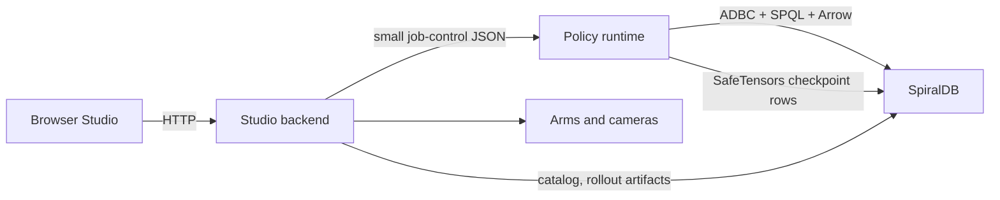

# Policy runtime

## Outcome

The policy runtime is a replaceable worker shared by Training and Rollout.
For training it owns the complete data/model/checkpoint loop; Studio is only
the orchestrator. SpiralDB remains the durable data store.

## Process boundary

## Ownership

- **RUNTIME-001** Studio must select and admit runs, submit immutable job
  specifications, request stop, mirror worker evidence into the UI, and admit
  motion.
- **RUNTIME-002** A training worker must own its SpiralDB connection, SPQL
  reads, sampling, normalization, model, optimizer, validation, telemetry, and
  checkpoint writes.
- **RUNTIME-003** No training state, action, image, or Arrow batch may pass
  through Studio.
- **RUNTIME-004** SpiralDB must remain the durable store; the worker may retain
  live job state in memory and must expose a replayable snapshot by job ID.
- **RUNTIME-005** A Studio shutdown must detach without stopping the worker. A
  restart must fetch and reattach to the active job, replay only evidence not
  already persisted, and tolerate temporary polling disconnections.
- **RUNTIME-006** A runtime setting change must apply only to new jobs and
  policy sessions.
- **RUNTIME-007** Settings must let the user select, save, connect, and test a
  runtime endpoint.
- **RUNTIME-008** Spiral client secrets must be write-only browser input,
  remain in the backend bootstrap store, be sent only in the job creation
  request, and never appear in snapshots, logs, or telemetry.

## Training job protocol

- **RUNTIME-009** API version 4 must expose `POST /v1/jobs`,
  `GET /v1/jobs/{id}`, `POST /v1/jobs/{id}/stop`, and
  `GET /v1/jobs/{id}/telemetry`.
- **RUNTIME-010** `POST /v1/jobs` must be idempotent when a caller-selected job
  ID and its complete specification match. Reusing an ID with a different
  specification must return a conflict. Studio must try `GET` first when
  reattaching so it does not need to resend credentials.
- **RUNTIME-011** The immutable job request must include the Spiral API and
  SpFS endpoints, project, namespace, optional client credentials, read-only
  SQL, state/action columns, camera/decode settings, model configuration,
  seed, step count, validation split, and checkpoint cadence.
- **RUNTIME-012** Job snapshots must include phase, current step, resolved data
  contract, append-only metrics, checkpoint metadata, and logs, but no secret.
- **RUNTIME-013** The worker must append each SafeTensors checkpoint directly
  to the configured namespace's `training_checkpoints` relation before
  publishing its checkpoint event.
- **RUNTIME-014** Worker-side SpiralDB connections must use per-database ADBC
  `username`, `password`, `spiral.api_url`, and `spiral.spfs_url` options; they
  must not mutate process-global endpoint or credential environment variables.
- **RUNTIME-015** The worker must use the `spiraldb` Python package and SPQL
  video frame selection, decode, optional resize, and Arrow image tensor
  conversion.
- **RUNTIME-016** The protocol must support more than one runtime
  implementation and must not require gRPC, Arrow Flight, Docker, or Compose.

## Rollout protocol

- **RUNTIME-017** Rollout policy load and inference may continue to use
  SafeTensors plus Arrow IPC because live observations originate in Studio's
  hardware process.
- **RUNTIME-018** Arrow IPC metadata V5 streams must use lossless Zstandard
  compression and packed HWC RGB `UInt8` image values.
- **RUNTIME-019** The runtime must move images to the selected device before
  converting to CHW `Float32` and applying ImageNet normalization.

## Current runtime

- **RUNTIME-020** The initial runtime must use LeRobot's PyTorch ACT
  implementation.
- **RUNTIME-021** The main Rust workspace must not link PyTorch or LibTorch.
- **RUNTIME-022** The Python runtime must remain outside the Rust workspace and
  use the locked `uv` environment.
- **RUNTIME-023** Missing GPU telemetry must be reported as unavailable and
  must never fail an otherwise successful step.
- **RUNTIME-024** The runtime must bind to loopback by default. SSH local
  forwarding is the standard remote path, providing encryption for the job
  request that carries Spiral credentials; a directly reachable deployment
  must use HTTPS and service authentication.
- **RUNTIME-025** Device strings must begin with the compact session device
  identifier and the runtime owns availability validation.
- **RUNTIME-026** Every optimizer metric must retain worker loader, device-copy,
  and model timing. Studio-side Arrow encode and upload timings are absent for
  worker-owned training jobs because there is no training data upload.

## Implementation ownership

- Versioned contracts: [`training/contracts`](../../training/contracts/)
- Studio job client: [`training/http-client`](../../training/http-client/)
- Worker job lifecycle: [`training/src/spiral_training_runtime/jobs.py`](../../training/src/spiral_training_runtime/jobs.py)
- Worker Spiral/SPQL loader: [`training/src/spiral_training_runtime/spiral.py`](../../training/src/spiral_training_runtime/spiral.py)
- Framework-neutral inference contract: [`spiral-robotics-inference`](../../crates/spiral-robotics-inference/)
