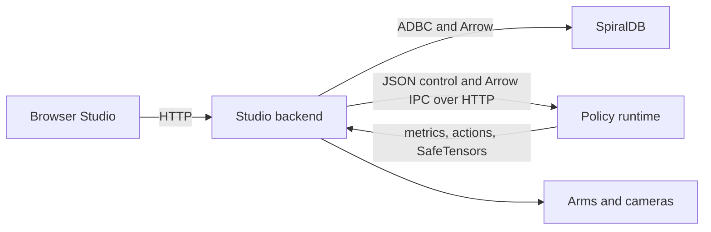

# Policy runtime

## Outcome

The policy runtime is a replaceable compute service shared by Training and
Rollout. Studio owns data and lifecycle; the runtime owns in-memory tensor
compute.

## Process boundary

## Ownership

- **RUNTIME-001** Studio must select datasets, construct batches, own run
  history, publish checkpoints, and admit motion.
- **RUNTIME-002** The runtime must own only in-memory model, optimizer, training,
  and inference sessions.
- **RUNTIME-003** The runtime must not open SpiralDB.
- **RUNTIME-004** The runtime must not become another durable application store.
- **RUNTIME-005** Deleting a session must release its runtime state.
- **RUNTIME-006** A runtime setting change must apply to new sessions and must
  not retarget an active session.
- **RUNTIME-007** Settings must let the user select, save, connect, and test a
  runtime endpoint.
- **RUNTIME-008** Stored runtime credentials must remain in the backend and must
  not be returned to the browser.

## Protocol

- **RUNTIME-009** Control operations must use HTTP with small JSON messages.
- **RUNTIME-010** Training and inference tensors must use Arrow IPC streams over
  HTTP.
- **RUNTIME-011** Checkpoints must use raw SafeTensors with explicit format
  metadata.
- **RUNTIME-012** The protocol must not require gRPC, Arrow Flight, Docker, or
  Compose.
- **RUNTIME-013** The protocol must support more than one runtime
  implementation.
- **RUNTIME-014** A runtime must expose health, capabilities, session lifecycle,
  training, validation, telemetry, checkpoint, policy load, warm-up, inference,
  and cancellation operations.
- **RUNTIME-015** Arrow buffers should be borrowed without another CPU copy when
  the framework permits it.
- **RUNTIME-016** GPU transfer must be measured separately from database and
  CPU preparation time.

## Current runtime

- **RUNTIME-017** The initial runtime must use the established LeRobot PyTorch
  ACT implementation.
- **RUNTIME-018** The main Rust workspace must not link PyTorch or LibTorch.
- **RUNTIME-019** The Python runtime must remain outside the Rust workspace.
- **RUNTIME-020** `uv` may provide the reproducible Python environment locally
  or on a remote compute machine.
- **RUNTIME-021** The runtime may be used on a trusted network without product
  deployment or multi-tenant security features for now.

## Implementation ownership

- Protocol and batch contracts:
  [`training/contracts`](../../training/contracts/)
- Studio HTTP client:
  [`training/http-client`](../../training/http-client/)
- Current Python runtime:
  [`training/src/spiral_training_runtime`](../../training/src/spiral_training_runtime/)
- Runtime documentation:
  [`training/README.md`](../../training/README.md)
- Framework-neutral inference contract:
  [`spiral-robotics-inference`](../../crates/spiral-robotics-inference/)
